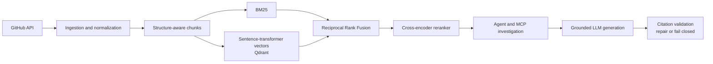

# GitHub Engineering Intelligence Agent

A source-grounded investigation system for understanding regressions, behavioral changes, fixes,
and releases across public GitHub repositories.

Given a question such as _“Why did timeout behavior change, and which PRs provide evidence?”_, the
system combines indexed repository history with targeted GitHub tools, produces a bounded public
investigation trace, and returns an answer whose citations are validated against real retrieved
sources.

## The problem

Engineering investigations rarely reduce to one keyword search. The relevant evidence may be split
across an issue describing symptoms, a fixing pull request using different terminology, comments
explaining edge cases, a commit, and the release that shipped the change.

GitHub's native search is useful for known identifiers and exact terms, but it does not provide:

- semantic retrieval when a question paraphrases the source;
- one ranking across issues, PRs, comments, commits, releases, and documentation;
- cross-source investigation and evidence deduplication;
- grounded synthesis with machine-validated citations;
- reproducible retrieval and generation evaluation.

This project implements that complete path while keeping retrieval, tool use, and generation
independently testable.

## Architecture



The normalized `GitHubDocument` contract preserves text, source type, repository, title, public
URL, GitHub ID, timestamps, and source-specific metadata. Structure-aware chunking retains those
fields and keeps issue/PR comments associated with their parents.

Retrieval runs BM25 and `sentence-transformers/all-MiniLM-L6-v2` independently, combines ranks
with RRF (`k=60`), and optionally reranks the fused candidate set with
`cross-encoder/ms-marco-MiniLM-L-6-v2`. Embedded Qdrant provides local vector persistence.

## Real investigation example

This is an abridged result from a real `investigate` run over the indexed HTTPX corpus.

**Question**

> Which change added IPv6 CIDR support to `no_proxy` matching, and what behavior did it correct?

**Public investigation trace**

1. Retrieved five hybrid-reranked HTTPX sources.
2. Searched related implementation pull requests through the GitHub tool layer.
3. Re-ran repository retrieval using discovered evidence terms.
4. Generated an answer from five deduplicated evidence sources.

**Tool and retrieval evidence**

- `search_pull_requests`: completed; no new source beyond the indexed evidence.
- `search_repository_documents`: completed; no new deduplicated source.
- Top supporting source: [HTTPX PR #3741](https://github.com/encode/httpx/pull/3741),
  “Fix no_proxy to support IPV6 CIDR format.”

**Grounded answer**

> PR #3741 added IPv6 CIDR support to `no_proxy` matching [S1]. Inference: before this change,
> IPv6 CIDR entries such as `fe11::/16` were not matched, so destinations in those ranges would not
> be exempted from proxying; the change made those patterns work as intended [S1].

**Citation**

- `[S1]` [Fix no_proxy to support IPV6 CIDR format](https://github.com/encode/httpx/pull/3741)

The run also reported that the retrieved summary did not contain the implementation diff or enough
issue detail to confirm the exact pre-change failure mode. The agent exposes limitations instead of
inventing missing evidence.

## Held-out retrieval benchmark v2

These are the **first held-out results**, recorded before any benchmark-driven tuning. The frozen v2
benchmark contains **54 new queries** across **FastAPI, Pydantic, and HTTPX**, with **74 verified
relevance labels**. The indexed corpus contains **892 normalized documents and 1,356 chunks**.

| Backend | Recall@5 | Recall@10 | MRR | NDCG@10 |
| --- | ---: | ---: | ---: | ---: |
| BM25 | 0.7608 | 0.8225 | 0.7068 | 0.7032 |
| Vector | 0.8519 | 0.8889 | 0.7722 | 0.7836 |
| Hybrid | 0.8225 | **0.9352** | **0.8013** | 0.8123 |
| Hybrid + reranker | **0.8688** | **0.9352** | 0.7972 | **0.8203** |

Reranking is not presented as universally beneficial. Against hybrid retrieval it improved six
queries, hurt five, and tied on 43 by per-query NDCG@10. Vector search beat BM25 on 20 queries,
BM25 beat vector on 14, and hybrid beat both on four. The benchmark was not used for subsequent
parameter tuning.

The original 20-query plumbing benchmark remains unchanged. Evaluation datasets are in
[`data/eval`](data/eval), and the v2 corpus snapshot is
[`data/corpus/benchmark_v2.jsonl`](data/corpus/benchmark_v2.jsonl).

## Generation evaluation

The initial generation evaluation ran nine questions—three per benchmark repository—through the
unchanged `hybrid_rerank` and grounded-generation pipeline.

| Result | Value |
| --- | ---: |
| Successful generations | 9 / 9 |
| Failed generations | 0 |
| Citation validity | 1.0000 |
| Detected claims | 39 |
| Claims counted as cited | 21 |
| Deterministic citation coverage | 0.5413 |
| Deterministic lexical groundedness | 0.4770 |

No nonexistent citation IDs were returned. Citation coverage and lexical groundedness are retained
for transparency but are **not headline quality claims**. Their deterministic sentence splitter can
separate a trailing `[S#]` from the preceding bullet-point claim; this caused two visibly cited
HTTPX answers to score zero for both measures. Lexical overlap is also not semantic entailment, an
LLM judge, a factuality score, or proof that an answer is correct. The initial results have not been
silently corrected.

Run the same harness with:

```bash
github-intel evaluate-generation \
  --dataset data/eval/generation.jsonl \
  --output output/generation-evaluation.json
```

## MCP and bounded investigation

The read-only stdio MCP server exposes six typed tools:

| Tool | Purpose |
| --- | --- |
| `search_issues` | Search issue reports in one repository |
| `get_issue` | Fetch an issue and its comments |
| `search_pull_requests` | Search implementation PRs |
| `get_pull_request` | Fetch a PR, conversation comments, and review comments |
| `get_release` | Fetch a release by exact tag |
| `search_repository_documents` | Search the local hybrid-reranked corpus |

The investigation workflow is:

1. Create a concise public plan.
2. Retrieve initial `hybrid_rerank` evidence.
3. Select targeted GitHub tools from the question and discovered identifiers.
4. Optionally retrieve again using discovered titles and terms.
5. Deduplicate evidence by public source URL.
6. Generate through the existing grounded-answer service.
7. Validate every source citation against the retrieved evidence set.

Retrieved GitHub text is always treated as untrusted data. Tool content cannot override system
instructions. Defaults cap an investigation at six trace steps, four MCP calls, and twelve evidence
sources. Tool failures, unavailable resources, rate limits, empty searches, and limit exhaustion
produce explicit limitations; no-evidence cases abstain.

`ask` is the direct retrieve-once-and-answer command. `investigate` adds planning, targeted GitHub
tools, follow-up retrieval, and a safe action trace.

## Run locally

Requirements: Python 3.11+ and Git. The first retrieval run downloads the configured embedding and
cross-encoder models from Hugging Face.

```bash
git clone https://github.com/aayushi1203/github-engineering-intelligence-rag.git
cd github-engineering-intelligence-rag

python3.11 -m venv .venv
source .venv/bin/activate
python -m pip install --upgrade pip
pip install -e '.[dev]'
cp .env.example .env
```

For the exact Python 3.11 dependency snapshot used by the verified test run:

```bash
pip install -r requirements.lock
pip install -e . --no-deps
```

Public ingestion works without a GitHub token, but a fine-grained read-only `GITHUB_TOKEN` raises
the API quota. `OPENAI_API_KEY` is required only for `ask`, `investigate`, and generation
evaluation. Never commit `.env`.

### Use the included benchmark corpus

```bash
github-intel index data/corpus/benchmark_v2.jsonl

github-intel search \
  "authentication timeout regression" \
  --repo encode/httpx \
  --backend hybrid_rerank \
  --top-k 5

github-intel ask \
  "Which change added IPv6 CIDR support to no_proxy?" \
  --repo encode/httpx

github-intel investigate \
  "Why did timeout behavior change and which PR provides evidence?" \
  --repo encode/httpx
```

### Ingest another public repository

```bash
github-intel ingest owner/repository --output output/repository.jsonl
github-intel index output/repository.jsonl
```

GitHub responses and ETags are cached under `.cache/github`. BM25 chunks default to `.cache/index`
and embedded Qdrant to `.cache/qdrant`. These generated artifacts are intentionally ignored by Git.

### Run the MCP server

```bash
github-intel-mcp
```

The server uses stdio and performs read-only GitHub operations.

## Reproduce retrieval evaluation

```bash
github-intel index data/corpus/benchmark_v2.jsonl
HF_HUB_OFFLINE=1 github-intel evaluate-retrieval \
  --dataset data/eval/retrieval_v2.jsonl \
  --top-k 10 \
  --output output/retrieval-evaluation-v2.json
```

Fixed v2 configuration:

- embedding model: `sentence-transformers/all-MiniLM-L6-v2`;
- reranker: `cross-encoder/ms-marco-MiniLM-L-6-v2`;
- RRF constant: 60;
- candidates per backend: 25;
- reranking pool: 40;
- evaluation depth: 10.

## Development

```bash
pytest
ruff check .
mypy src
git diff --check
```

The current repository passes 57 tests, Ruff, and strict MyPy across 41 source files.

## Repository layout

```text
.
├── data/
│   ├── corpus/                 # reproducible normalized benchmark snapshots
│   └── eval/                   # retrieval and generation JSONL datasets
├── src/github_intelligence/
│   ├── agent/                  # bounded planning and investigation workflow
│   ├── evaluation/             # Recall@K, MRR, NDCG, and diagnostics
│   ├── generation/             # providers, prompts, citations, and generation evaluation
│   ├── github/                 # cached, rate-limit-aware GitHub REST client
│   ├── ingestion/              # source ingestion and normalization
│   ├── mcp/                    # typed read-only MCP tools and stdio server
│   ├── models/                 # normalized documents and retrieval contracts
│   └── retrieval/              # chunking, BM25, Qdrant, RRF, and reranking
├── tests/unit/
├── .env.example
├── pyproject.toml
└── requirements.lock
```

## License

MIT. See [LICENSE](LICENSE).
