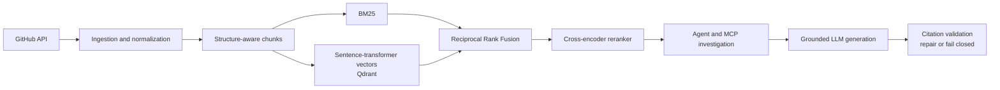
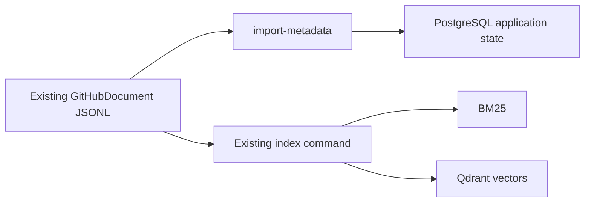
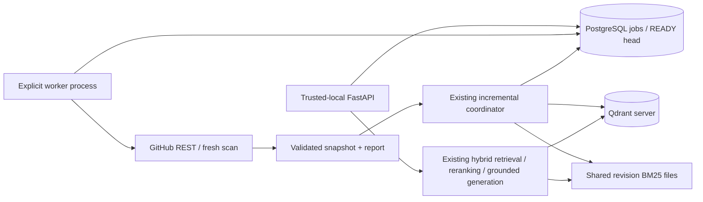
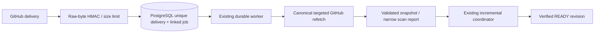

# GitHub Engineering Intelligence Agent

A source-grounded investigation system for understanding regressions, behavioral changes, fixes,
and releases across public GitHub repositories.

Given a question such as _“Why did timeout behavior change, and which PRs provide evidence?”_, the
system combines indexed repository history with targeted GitHub tools, produces a bounded public
investigation trace, and returns an answer whose citations are validated against real retrieved
sources.

## The problem

Engineering investigations rarely reduce to one keyword search. The relevant evidence may be split
across an issue describing symptoms, a fixing pull request using different terminology, comments
explaining edge cases, a commit, and the release that shipped the change.

GitHub's native search is useful for known identifiers and exact terms, but it does not provide:

- semantic retrieval when a question paraphrases the source;
- one ranking across issues, PRs, comments, commits, releases, and documentation;
- cross-source investigation and evidence deduplication;
- grounded synthesis with machine-validated citations;
- reproducible retrieval and generation evaluation.

This project implements that complete path while keeping retrieval, tool use, and generation
independently testable.

## Architecture



The normalized `GitHubDocument` contract preserves text, source type, repository, title, public
URL, GitHub ID, timestamps, and source-specific metadata. Structure-aware chunking retains those
fields and keeps issue/PR comments associated with their parents.

Retrieval runs BM25 and `sentence-transformers/all-MiniLM-L6-v2` independently, combines ranks
with RRF (`k=60`), and optionally reranks the fused candidate set with
`cross-encoder/ms-marco-MiniLM-L-6-v2`. Embedded Qdrant provides local vector persistence.

## Real investigation example

This is an abridged result from a real `investigate` run over the indexed HTTPX corpus.

**Question**

> Which change added IPv6 CIDR support to `no_proxy` matching, and what behavior did it correct?

**Public investigation trace**

1. Retrieved five hybrid-reranked HTTPX sources.
2. Searched related implementation pull requests through the GitHub tool layer.
3. Re-ran repository retrieval using discovered evidence terms.
4. Generated an answer from five deduplicated evidence sources.

**Tool and retrieval evidence**

- `search_pull_requests`: completed; no new source beyond the indexed evidence.
- `search_repository_documents`: completed; no new deduplicated source.
- Top supporting source: [HTTPX PR #3741](https://github.com/encode/httpx/pull/3741),
  “Fix no_proxy to support IPV6 CIDR format.”

**Grounded answer**

> PR #3741 added IPv6 CIDR support to `no_proxy` matching [S1]. Inference: before this change,
> IPv6 CIDR entries such as `fe11::/16` were not matched, so destinations in those ranges would not
> be exempted from proxying; the change made those patterns work as intended [S1].

**Citation**

- `[S1]` [Fix no_proxy to support IPV6 CIDR format](https://github.com/encode/httpx/pull/3741)

The run also reported that the retrieved summary did not contain the implementation diff or enough
issue detail to confirm the exact pre-change failure mode. The agent exposes limitations instead of
inventing missing evidence.

## Held-out retrieval benchmark v2

These are the **first held-out results**, recorded before any benchmark-driven tuning. The frozen v2
benchmark contains **54 new queries** across **FastAPI, Pydantic, and HTTPX**, with **74 verified
relevance labels**. The indexed corpus contains **892 normalized documents and 1,356 chunks**.

| Backend | Recall@5 | Recall@10 | MRR | NDCG@10 |
| --- | ---: | ---: | ---: | ---: |
| BM25 | 0.7608 | 0.8225 | 0.7068 | 0.7032 |
| Vector | 0.8519 | 0.8889 | 0.7722 | 0.7836 |
| Hybrid | 0.8225 | **0.9352** | **0.8013** | 0.8123 |
| Hybrid + reranker | **0.8688** | **0.9352** | 0.7972 | **0.8203** |

Reranking is not presented as universally beneficial. Against hybrid retrieval it improved six
queries, hurt five, and tied on 43 by per-query NDCG@10. Vector search beat BM25 on 20 queries,
BM25 beat vector on 14, and hybrid beat both on four. The benchmark was not used for subsequent
parameter tuning.

The original 20-query plumbing benchmark remains unchanged. Evaluation datasets are in
[`data/eval`](data/eval), and the v2 corpus snapshot is
[`data/corpus/benchmark_v2.jsonl`](data/corpus/benchmark_v2.jsonl).

## Generation evaluation

The initial generation evaluation ran nine questions—three per benchmark repository—through the
unchanged `hybrid_rerank` and grounded-generation pipeline.

| Result | Value |
| --- | ---: |
| Successful generations | 9 / 9 |
| Failed generations | 0 |
| Citation validity | 1.0000 |
| Detected claims | 39 |
| Claims counted as cited | 21 |
| Deterministic citation coverage | 0.5413 |
| Deterministic lexical groundedness | 0.4770 |

No nonexistent citation IDs were returned. Citation coverage and lexical groundedness are retained
for transparency but are **not headline quality claims**. Their deterministic sentence splitter can
separate a trailing `[S#]` from the preceding bullet-point claim; this caused two visibly cited
HTTPX answers to score zero for both measures. Lexical overlap is also not semantic entailment, an
LLM judge, a factuality score, or proof that an answer is correct. The initial results have not been
silently corrected.

Run the same harness with:

```bash
github-intel evaluate-generation \
  --dataset data/eval/generation.jsonl \
  --output output/generation-evaluation.json
```

## MCP and bounded investigation

The read-only stdio MCP server exposes six typed tools:

| Tool | Purpose |
| --- | --- |
| `search_issues` | Search issue reports in one repository |
| `get_issue` | Fetch an issue and its comments |
| `search_pull_requests` | Search implementation PRs |
| `get_pull_request` | Fetch a PR, conversation comments, and review comments |
| `get_release` | Fetch a release by exact tag |
| `search_repository_documents` | Search the local hybrid-reranked corpus |

The investigation workflow is:

1. Create a concise public plan.
2. Retrieve initial `hybrid_rerank` evidence.
3. Select targeted GitHub tools from the question and discovered identifiers.
4. Optionally retrieve again using discovered titles and terms.
5. Deduplicate evidence by public source URL.
6. Generate through the existing grounded-answer service.
7. Validate every source citation against the retrieved evidence set.

Retrieved GitHub text is always treated as untrusted data. Tool content cannot override system
instructions. Defaults cap an investigation at six trace steps, four MCP calls, and twelve evidence
sources. Tool failures, unavailable resources, rate limits, empty searches, and limit exhaustion
produce explicit limitations; no-evidence cases abstain.

`ask` is the direct retrieve-once-and-answer command. `investigate` adds planning, targeted GitHub
tools, follow-up retrieval, and a safe action trace.

## Run locally

Requirements: Python 3.11+ and Git. The first retrieval run downloads the configured embedding and
cross-encoder models from Hugging Face.

```bash
git clone https://github.com/aayushi1203/github-engineering-intelligence-rag.git
cd github-engineering-intelligence-rag

python3.11 -m venv .venv
source .venv/bin/activate
python -m pip install --upgrade pip
pip install -e '.[dev]'
cp .env.example .env
```

For the exact Python 3.11 dependency snapshot used by the verified test run:

```bash
pip install -r requirements.lock
pip install -e . --no-deps
```

Public ingestion works without a GitHub token, but a fine-grained read-only `GITHUB_TOKEN` raises
the API quota. `OPENAI_API_KEY` is required only for `ask`, `investigate`, and generation
evaluation. Never commit `.env`.

### Use the included benchmark corpus

```bash
github-intel index data/corpus/benchmark_v2.jsonl

github-intel search \
  "authentication timeout regression" \
  --repo encode/httpx \
  --backend hybrid_rerank \
  --top-k 5

github-intel ask \
  "Which change added IPv6 CIDR support to no_proxy?" \
  --repo encode/httpx

github-intel investigate \
  "Why did timeout behavior change and which PR provides evidence?" \
  --repo encode/httpx
```

### Ingest another public repository

```bash
github-intel ingest owner/repository --output output/repository.jsonl
github-intel index output/repository.jsonl
```

Ingestion defaults to fresh GitHub state, revalidating cached ETags. `--cached` explicitly
allows TTL cache reuse. Cache namespaces isolate API origins and credential identities;
raw tokens are never persisted. Retry-After seconds/dates, primary and secondary rate
limits, transport errors and transient server errors receive bounded retries.
`GITHUB_MAX_RETRIES` is the total attempt budget; `GITHUB_MAX_RETRY_WAIT_SECONDS`
(default 300) bounds acceptable waits. A longer server-required wait fails explicitly
instead of retrying early.

Documentation is discovered at a pinned tree and fetched by immutable blob SHA.
Repository ID, stable typed source keys, branch/path, commit and blob identities,
authors, URLs and available timestamps accompany normalized documents. Full PR review
summaries supplement existing conversation and inline comments; empty summaries are
tracked without emitting empty documents. Legacy chunk IDs remain unchanged.

Successful ingestion publishes JSONL plus `<output>.scan.json`. Source scans distinguish
complete, intentionally limited, truncated and failed enumeration. Excluded families
are explicitly limited. `--allow-incomplete` permits deliberate partial snapshots;
failed ingestion still fails. A failure writes `<output>.failed-scan.json` and preserves
the previous successful snapshot. Publication uses temporary files and atomic renames;
the two-file pair is validated by `ingestion.snapshot.load_snapshot_report`, which
checks the JSONL checksum. Future reconciliation must use that validator, not just
read the JSONL. Mutable issue/PR pagination is best-effort, and page/high-water hints
are not safe deletion evidence or guaranteed resumable cursors.

After upgrading persistence with `alembic upgrade head`, metadata imports also support
`pull_request_review`. Migration 0002 only extends the document source-type constraint;
downgrade refuses while review rows exist, avoiding silent data loss.

GitHub responses and ETags are cached under `.cache/github`. BM25 chunks default to `.cache/index`
and embedded Qdrant to `.cache/qdrant`. These generated artifacts are intentionally ignored by Git.

### Run the MCP server

```bash
github-intel-mcp
```

The server uses stdio and performs read-only GitHub operations.

## Reproduce retrieval evaluation

```bash
github-intel index data/corpus/benchmark_v2.jsonl
HF_HUB_OFFLINE=1 github-intel evaluate-retrieval \
  --dataset data/eval/retrieval_v2.jsonl \
  --top-k 10 \
  --output output/retrieval-evaluation-v2.json
```

Fixed v2 configuration:

- embedding model: `sentence-transformers/all-MiniLM-L6-v2`;
- reranker: `cross-encoder/ms-marco-MiniLM-L-6-v2`;
- RRF constant: 60;
- candidates per backend: 25;
- reranking pool: 40;
- evaluation depth: 10.

## Development

### Optional application metadata (Phase 1 implemented)

The existing CLI, MCP, retrieval, and evaluation workflows still run without
PostgreSQL or the persistence extra. PostgreSQL stores application metadata;
Qdrant remains the vector store and BM25 remains the lexical retriever.



Install the optional dependencies and start local PostgreSQL 16:

```bash
pip install -e '.[dev,persistence]'
# Set both locally; Compose validates variables even for inactive profiles.
export POSTGRES_PASSWORD='<choose-a-local-password>'
export POSTGRES_TEST_PASSWORD='<choose-a-disposable-test-password>'
docker compose up -d --wait postgres
export DATABASE_URL='postgresql+psycopg://github_intel:<url-encoded-local-password>@127.0.0.1:5432/github_intel'
alembic upgrade head
github-intel import-metadata data/corpus/benchmark_v2.jsonl
```

`DATABASE_URL` can also be set in your uncommitted `.env`. Never put credentials
in `alembic.ini`. A missing database, missing migration, or invalid input causes a
nonzero import result with a sanitized message. No schema is created implicitly.

The importer validates the whole input and commits one transaction. The initial
benchmark import reports `new=892`; repeating it reports `unchanged=892`, without
altering stored timestamps, versions, or index status. Changed records update the
same document row and become `pending`. **Importing metadata does not embed, index,
fetch GitHub content, or infer deletions.** Existing `ingest` and `index` commands
retain their current behavior.

| Table | Purpose |
| --- | --- |
| `users` | Optional external identity; authentication is planned |
| `repositories` | Canonical owner/name, optional provider ID, visibility, branch and owner |
| `documents` | Typed stable source identity, URLs, author/source timestamps, SHA, versioned hash, normalized payload and index status |
| `ingestion_jobs` | Persisted lifecycle, progress, scoped idempotency key and controlled error details |
| `queries` | Request/correlation identifiers, provider/configuration and measurements |
| `answers` | Numbered attempts, outcome, citation validation and source references |
| `feedback` | Positive/negative rating and optional failure category |

Document IDs use UUID5 over canonical repository, source type and source key.
Documentation uses branch/path, preserving identity when a blob SHA changes.
Content hashes use versioned canonical JSON and exclude ingestion/index bookkeeping.
Source metadata lives inside one normalized payload; source timestamps are named
`source_created_at`/`source_updated_at` to distinguish them from application row
timestamps. Legacy chunk IDs and all retrieval scoring remain unchanged.

Query/answer text and free-text limitations are omitted by default; persistence
operations require `store_content=True` to retain them. Answer records store
reference-only citations rather than copied evidence bodies. Structured metadata
rejects credential-bearing keys. This does not scan GitHub source text for secrets:
the normalized document itself remains source content, so review retention and
access policy before importing private repositories. No tokens are read or stored
by the metadata importer.

Persistence operations accept a SQLAlchemy session and leave transaction ownership
to the caller. Repository row locks serialize document writes; sorted repository
lock order prevents import batches from deadlocking across repositories. Database
constraints enforce typed source identity, allowed statuses, foreign keys, unique
request/attempt keys and nonnegative progress. Job transition operations validate
the lifecycle; the Phase 4 worker below now executes durable ingestion jobs.

Run the PostgreSQL integration suite against an explicitly disposable database:

```bash
docker compose --profile test up -d --wait postgres-test
export TEST_DATABASE_URL='postgresql+psycopg://github_intel_test:<url-encoded-test-password>@127.0.0.1:55432/github_intel_test'
pytest
ruff check .
mypy src
```

Integration tests create and remove randomly named schemas, apply migrations, and
verify upgrade → downgrade → re-upgrade, schema/model alignment, real constraints,
rollback, concurrent duplicates, changed documents, lifecycle and content retention.
`TEST_DATABASE_URL` must be exported (tests do not load it from `.env`) and its
database name must contain `test`; it must never reference production data. Missing
test configuration or optional dependencies explicitly skips PostgreSQL tests;
skips are not evidence that persistence passed. Source unit tests still run without
the persistence extra. `compose.yaml` keeps test data in tmpfs, separate from the
application's `postgres_data` volume. `alembic downgrade base` deletes application
tables and is appropriate only on a disposable database for this verification.

Application persistence, metadata import, GitHub ingestion hardening and the opt-in
Phase 3 incremental coordinator, trusted-local HTTP API, durable worker and GitHub
webhook synchronization are implemented. A frontend, query instrumentation, feedback UI/API
and production deployment
remain planned. Existing optional tool-policy training code remains separate; these phases
do not launch training. See [the productionization plan](docs/productionization-plan.md).

### Durable ingestion and HTTP API (Phase 4 implemented)



HTTP ingestion requests only commit durable jobs. Start the worker separately;
FastAPI does not schedule ingestion as an in-process background task. Public stages
are `QUEUED → FETCHING → PARSING → EMBEDDING → INDEXING → COMPLETE`, or `FAILED`.
Phase 2 fetches and normalizes together; `PARSING` records snapshot validation,
while `index_stage` reports the actual Phase 3 boundary. Progress counts normalized
documents rather than inventing a percentage for GitHub pagination.

PostgreSQL `FOR UPDATE SKIP LOCKED` claims jobs atomically. Each claim gets a unique
lease grant and increments persisted attempts. Heartbeats extend a valid lease;
expired grants can be reclaimed. Ownership is checked again in the same transaction
that publishes READY. An old worker cannot publish after losing its lease. A failed
attempt records a controlled error code, retry eligibility and next attempt time.
Transient GitHub/storage failures use bounded exponential backoff; GitHub deadlines
can extend the delay. Invalid contracts, configuration and authorization failures
are terminal. Defaults: one worker slot, 90-second lease, 15-second heartbeat,
2-second idle poll, four attempts, 5-to-300-second backoff. Multiple worker processes
use the same PostgreSQL claims and per-repository coordinator lock.

A successfully validated job snapshot is reused after interruption. Phase 3 replays
its persisted operation; READY and the job's result reference commit together,
and completion can be retried afterward. The previous READY revision remains
readable if a new attempt fails. This is replayable coordination across stores,
not a distributed transaction. Shutdown stops new claims and cancels fetches;
in-flight synchronous model/storage work reaches a safe boundary before exiting.

#### Local startup

```bash
pip install -e '.[application]'
# Configure .env from .env.example: DATABASE_URL, POSTGRES_PASSWORD, GITHUB_TOKEN,
# OPENAI_API_KEY, and a pinned EMBEDDING_MODEL + APPLICATION_EMBEDDING_VERSION.
docker compose up -d postgres qdrant
alembic upgrade head
mkdir -p .cache/application-index
github-intel worker
# In another terminal, with the same environment and working directory:
github-intel serve --host 127.0.0.1 --port 8000
```

Use an identical absolute `APPLICATION_ROOT` in both processes if working directories
differ; this must be durable shared storage for snapshots and revision BM25 files.
`APPLICATION_QDRANT_MODE=server` and `APPLICATION_QDRANT_URL` configure the shared
server. The optional Qdrant API key stays in configuration. The application uses
`application_chunks`, isolated from the benchmark collection. Embedded Qdrant stays
available for the existing offline/single-process workflows; API and worker startup
reject it. `APPLICATION_EMBEDDING_VERSION` records identity, and does not itself select
or validate a remote weight revision. Both processes must use the same model,
chunker, storage and version settings. `github-intel worker --once` claims at most
one available job for operator/debug use. `index-incremental` / `retire-index`
accept `--qdrant-mode server` when operating on these application revisions.

| Route | Behavior |
| --- | --- |
| `POST /repositories` | Register canonical `{"name":"owner/repo"}` metadata locally; returns 201. |
| `GET /repositories/{id}` | Repository metadata and current READY revision or NOT_INDEXED. |
| `POST /repositories/{id}/ingestions` | `{"idempotency_key":"scan-001"}` queues/reuses a job; returns 202. Optional comments/documentation/reviews selectors and `reconcile` flag. |
| `GET /ingestion-jobs/{id}` | Stage, attempts, progress, lease timestamps, retry schedule, sanitized error and result revision. |
| `POST /repositories/{id}/query` | `{"question":"What changed?"}` queries the pinned READY revision. `store_content: true` opts into raw query/answer retention. |
| `GET /health/live` | Process liveness. |
| `GET /health/ready` | Bounded DB/schema, Qdrant, shared-root and provider-configuration checks; 503 when unavailable. |

Duplicate keys reuse the same job; changing that key's scope is a 409 conflict.
Each query resolves READY anew and loads its corresponding BM25 file, avoiding stale
long-lived lexical state. Vector search is restricted to that revision's manifest.
Missing repository is 404; not indexed/conflicting scope is 409; malformed request
is 422. Missing evidence/configuration or retrieval infrastructure failures are 503;
generation/citation-validation failures are 502. No matching evidence returns an
explicit `insufficient_evidence` result. Existing citation validation is reused.
Queries and answers retain references and outcomes by default, with raw text opt-in.
Provider bodies, credentials and request/evidence text are not emitted by API errors;
CLI serving disables access logging. Health checks do not call the model provider or
claim that externally hosted model credentials have been verified.

This remains a local, trusted-user boundary without authentication or private
multi-user authorization. Keep the bind address loopback. The webhook receipt boundary
is described below. No frontend, feedback endpoint, dashboard, deployment automation
or training execution was added.
For server integration tests, export `TEST_QDRANT_URL` to a disposable real Qdrant
server in addition to `TEST_DATABASE_URL`; tests use uniquely named collections and
schemas. GitHub/provider boundary fixtures are controlled, not live-service tests.

### GitHub webhooks (Phase 5 implemented)



`POST /webhooks/github` verifies `X-Hub-Signature-256` with HMAC-SHA256 and
constant-time comparison over the exact bytes before JSON parsing. The streaming
body limit defaults to 1 MB and is configurable up to 25 MB. See
[GitHub's signature guidance](https://docs.github.com/en/webhooks/using-webhooks/validating-webhook-deliveries).
Enable the endpoint explicitly; disabled handling returns 503:

```bash
# Configure both application processes; use a random secret of at least 32 bytes.
export GITHUB_WEBHOOKS_ENABLED=true
export GITHUB_WEBHOOK_SECRET="$(python -c 'import secrets; print(secrets.token_urlsafe(32))')"
export GITHUB_WEBHOOK_MAX_BODY_BYTES=1000000
alembic upgrade head
github-intel worker
# In another terminal using the same environment:
github-intel serve --host 127.0.0.1 --port 8000
```

Configure the GitHub webhook for JSON, the same secret, and the events below.
Local tests use controlled transports rather than live GitHub. A remote GitHub
installation needs HTTPS forwarding to **only** the receipt route; the operator
API remains trusted-local without authentication and must not be exposed alongside
it. Provisioning public routing or a GitHub App is outside this phase.

| Event | Canonical refresh scope | Policy |
| --- | --- | --- |
| `issues` | One issue + its comments | Closure is an update. Signed `deleted` may remove only the matching known issue. |
| `issue_comment` | Parent issue + comments, or full PR conversation for a PR parent | Signed `deleted` may remove the exact known comment. |
| `pull_request` | One PR + conversation comments, inline comments and review bodies | Closed/merged PRs remain indexed canonical records. |
| `pull_request_review` | Same complete PR conversation scope | Dismissal is an update, not deletion. |
| `pull_request_review_comment` | Same complete PR conversation scope | Signed `deleted` may remove the exact known inline comment. |
| `release` | One release by native ID | Signed `deleted` may remove the exact known release. |
| Default-branch `push` | Current default-branch commit enumeration + documentation tree | Resolve current head once; fetch tree/blobs by immutable SHA. Existing conservative documentation reconciliation applies. |
| Other-branch `push` | None | Recorded/acknowledged as `branch_not_indexed`; this application has no additional branch scopes. |
| Known native repository rename | None | Recorded/acknowledged as DEFERRED; operator migration required. |
| Other events, including `ping` | None | Recorded/acknowledged as `unsupported_event`. |

The delivery table stores UUID delivery ID, event/action, native repository identity,
receive time, controlled source/ref/revision metadata, optional source timestamp,
body SHA256 fingerprint, status and job link. It never stores the body, headers,
credentials or secret. `GET /webhook-deliveries/{delivery_id}` shows the receipt and
linked job status. Uniqueness and transactional enqueue ensure concurrent duplicates
create one delivery and one logical request. Reusing an ID with different bytes/event
is a 409 conflict. Unknown repositories are recorded as ignored and acknowledged;
no repository is automatically created. A known native ID with a changed name is
DEFERRED for operator migration rather than creating another repository. A newly
registered repository without a native ID can accept a name-matched event, but the
worker must verify its expected native ID against fresh GitHub metadata before indexing.

Same-target, same-configuration events may share an unclaimed QUEUED job. All
issue/PR dependencies remain included, and deletion permission can widen only before
claiming. Active or attempted jobs are immutable; new events get a follow-up job.
Deliveries retain individual job links. Repository queue ordering prevents a follow-up
from overtaking active or retrying work; other repositories remain independently
claimable. No timed batching, external queue or payload-derived document path is used.

Late/out-of-order events refetch current state. Push `after`, `forced` and optional
source timestamps are diagnostic metadata, not permission to replace current state
with an old payload. Default pushes enumerate current immutable-head commits rather
than trusting a possibly truncated commit list. Forced pushes preserve historical
commits; absence is not proof of commit deletion. Default-branch deletion/empty-repository
head resolution fails honestly and preserves the previous READY revision.

Target reports declare only their requested families and exact parent scope; other
families are intentionally LIMITED. COMPLETE means successful enumeration of that
scope, not repository-wide completeness or GitHub snapshot isolation. Explicit
removal requires a persisted authenticated deletion delivery, matching fresh native
repository identity, matching typed source/parent identity, a complete fresh target
scan, and absence from its observed membership. A source still present wins over a
late deletion. Ambiguous 404, limits, truncation and failure cannot authorize removal.
Issue deletion does not cascade through historical comments. Old revision vectors
remain available for pinned readers until explicit retirement.

Responses: new actionable receipt **202**; duplicate/ignored/deferred receipt **200**;
invalid signature **401**; malformed authenticated JSON/payload/headers **400**;
conflicting delivery ID **409**; oversized body **413**; disabled or unavailable
subsystem **503**. Malformed authenticated payloads with valid delivery/event headers
are durably terminal FAILED. Unusable headers/signatures/oversized bodies are rejected
without a receipt. The transaction commits before acceptance; bounded database lock
and statement timeouts prevent receipt from waiting on ingestion work indefinitely.
HTTP receipt never performs fetching/indexing. Once recorded, downstream transient
failures use existing job retries, leases, snapshot replay and READY publication.
Receipt statuses track ACCEPTED/PROCESSING/COMPLETE/FAILED; the linked job exposes
retry scheduling and sanitized failure categories.

For missed events/downtime/force pushes, use the existing manual endpoint with a new
idempotency key and `reconcile: true`:

```text
POST /repositories/{id}/ingestions
{"idempotency_key":"reconcile-2026-10-05","reconcile":true}
```

This runs a full fresh scan through selective incremental indexing, not destructive
vector replacement. To recover a terminal failed prepared operation after repairing
its cause, `POST /ingestion-jobs/{id}/retry` requeues that same job with a new bounded
attempt budget. Lifetime attempts, snapshot and operation are preserved; automatic
retryable jobs and active/completed jobs cannot be manually requeued. After replay,
queue a fresh manual scan if more recent GitHub changes need collection. Retry does
not repair an invalid configuration/plan itself. Native renames remain deferred, and
mutable-source absence during manual scanning still cannot prove missed deletions.
No automatic receipt retention, private multi-user authorization, webhook registration,
observability infrastructure, CI/CD, frontend or training execution was added.

### Incremental application indexing (Phase 3 implemented)

The existing `index` command still builds full snapshots with legacy chunk IDs and
requires no PostgreSQL. The application path uses separate storage and explicit
revision manifests:

```bash
pip install -e '.[persistence]'
alembic upgrade head
github-intel ingest owner/repository --output output/repository.jsonl
github-intel index-incremental output/repository.jsonl \
  --repo owner/repository --embedding-version <immutable-weight-revision>
```

`DATABASE_URL` is required only for persistence/incremental commands. The application
root defaults to `.cache/application-index` (`--root` overrides it); its Qdrant
collection is `application_chunks`. The CLI prefixes the declared embedding version
with `EMBEDDING_MODEL`. Point `EMBEDDING_MODEL` at a pinned checkpoint and supply its immutable revision/hash.
`--embedding-version` records identity; it does not select a remote model revision.
A mutable label cannot establish reproducible embedding identity. Chunker settings
retain `CHUNK_MAX_WORDS` and `CHUNK_OVERLAP_WORDS`; their values enter its version.
No additional environment variables or services are required.


The coordinator compares persistent document hashes and the previous READY manifest.
Unchanged indexed documents reuse chunks and vectors. New/changed documents alone are
chunked; identical text can reuse an existing same-version embedding even when metadata
changes. BM25 rebuilds statistics from the repository revision's canonical current chunks
with the existing formula. Application IDs (`application-chunk-v1`) include repository
UUID, source type/key, ordinal, payload digest and chunker/embedding versions. The frozen
benchmark IDs and scoring implementation are untouched.

Progress is persisted as PREPARING → VECTOR_WRITES → LEXICAL_BUILD → VERIFYING → READY,
with FAILED plus the failed stage on recoverable exceptions. A session advisory lock
serializes operations for one repository across progress commits. Retrying the same
snapshot/configuration reuses its prepared manifest, checks existing points and converges
without duplication. A pending operation must be replayed or explicitly retired before
a newer snapshot. Concurrent metadata imports are detected before publication; retire
an obsolete failed plan and prepare a new scan rather than overwriting that import.

`--reconcile` permits deletion only for fresh COMPLETE documentation scans against a
new immutable tree, with the same known branch/selector scope and unambiguous membership.
Mutable pagination, limits, truncation, failed/excluded families, cached state, unknown
filters, observed-but-omitted sources and same-tree membership conflicts preserve absent
documents and print reasons. Checksums, document membership/counts, repository identity
and documentation revision scopes are validated before mutation. READY means the two
retrieval stores agree for this revision; it does not claim a complete GitHub scan.
Incomplete/excluded families are also printed by the CLI.

Readers use `IncrementalCoordinator.ready(repository)` to pin the last published revision,
then its `lexical.search(...)` / `vector_search(...)` methods. Vector search is constrained
to exact persisted membership, and missing/corrupt records fail closed. Do not search the
raw application collection with the legacy snapshot retriever: it contains unpublished
and retained historical points. Old READY revisions remain usable after failures and
later successful publications; there is no distributed transaction guarantee.

Stale chunks leave current retrieval membership immediately, but their physical records
are retained for pinned old readers. After those readers have drained, explicitly reclaim
an old or obsolete failed revision:

```bash
github-intel retire-index <operation-uuid> --repo owner/repository \
  --embedding-version <the-operation-weight-revision>
```

Retirement refuses the current READY revision, protects chunks referenced by any other
live operation, and persists RETIRING before deleting known IDs. Retry the same retirement
after interruption; it finishes as RETIRED. Audit manifests remain in PostgreSQL. Retirement
is manual: there are no reader leases or automatic retention policy. Unfinished jobs
protect their resulting READY revision from retirement.
An empty canonical revision has honest empty retrieval results; it does not invent a
GitHub commit. Phase 2 ingestion of a repository without a resolvable branch still fails
explicitly.

The implementation targets the existing embedded Qdrant deployment. One process owns
an embedded path; different repositories can use a shared client in that process.
PostgreSQL locks prevent repository conflicts but do not remove Qdrant's process-level
path lock. Server-mode Qdrant, cross-repository application search and managed retention
remain separate future work. Repository renames require explicit metadata migration;
source identity conflicts are rejected rather than silently creating a second index.

The repository has pre-existing formatting debt; Phase 1 does not reformat unrelated
files. Check formatting of new persistence, migration and test files with:

```bash
ruff format --check src/github_intelligence/persistence migrations \
  tests/integration tests/unit/test_document_identity.py
```

```bash
pytest
ruff check .
mypy src
git diff --check
```

## Bounded post-training experiment

The optional post-training experiment trains only the next-tool routing policy. Retrieval,
reranking, MCP implementations, prompts used by the production agent, and answer generation stay
frozen. FastAPI is the training repository, Pydantic is development-only, and HTTPX is held out.

Prepare 54 labeled benchmark examples plus 180 training-only routing examples derived from real,
URL-preserving FastAPI corpus records:

```bash
github-intel prepare-policy-data \
  --evaluation data/eval/retrieval_v2.jsonl \
  --corpus data/corpus/fastapi.jsonl \
  --corpus data/corpus/pydantic.jsonl \
  --corpus data/corpus/httpx_v2.jsonl \
  --splits data/post_training/splits.json \
  --augment-training-from-corpus 180 \
  --augment-test-from-corpus 42 \
  --output data/post_training/policy.jsonl
```

The checked-in dataset contains 198 training, 18 development, and 60 held-out examples. The test
split preserves the original 18 investigation questions and adds 42 pre-training, corpus-derived
HTTPX routing cases to reduce sampling noise. Every
gold source ID resolves to an ingested public GitHub URL. Corpus-derived augmentation is confined
to the training repository.

Install the isolated training stack on a CUDA Linux host, then run SFT followed by GRPO:

```bash
pip install -e '.[rl]'

github-intel train-policy \
  --stage sft \
  --dataset data/post_training/policy.jsonl \
  --model Qwen/Qwen3-4B \
  --output artifacts/policy-sft \
  --max-steps 75

github-intel train-policy \
  --stage grpo \
  --dataset data/post_training/policy.jsonl \
  --model artifacts/policy-sft \
  --output artifacts/policy-grpo \
  --max-steps 150 \
  --num-generations 4
```

Evaluate each checkpoint with identical greedy decoding on the frozen HTTPX split:

```bash
github-intel evaluate-policy \
  --dataset data/post_training/policy.jsonl \
  --model Qwen/Qwen3-4B \
  --split test \
  --output artifacts/policy-experiment/reports/base.json

github-intel evaluate-policy \
  --dataset data/post_training/policy.jsonl \
  --model artifacts/policy-sft \
  --split test \
  --output artifacts/policy-experiment/reports/sft.json

github-intel evaluate-policy \
  --dataset data/post_training/policy.jsonl \
  --model artifacts/policy-grpo \
  --split test \
  --output artifacts/policy-experiment/reports/grpo.json
```

On a CUDA Linux host, `scripts/run_policy_experiment.sh` runs the three evaluations and both
training stages in order, records wall-clock timing and package/GPU information, and stops on the
first failure. Reports separate the original 18 held-out investigations (`core`) from the 42
pre-registered corpus-derived cases (`corpus_derived`).

The GRPO reward is deliberately narrow and deterministic: 60% correct tool routing and 40% valid
structured action/arguments. Invalid JSON receives `-0.5`. It does not use an LLM judge, lexical
groundedness, retrieval scores, or answer quality. No improvement should be claimed until the base,
SFT, and SFT+GRPO checkpoints are evaluated under identical conditions on the held-out HTTPX split.

Phase 5 verification includes the original suites and durable-job/API/webhook tests,
real PostgreSQL and server Qdrant, Ruff, and strict MyPy across 75 files.
See the productionization plan for exact verification results.

## Repository layout

```text
.
├── data/
│   ├── corpus/                 # reproducible normalized benchmark snapshots
│   └── eval/                   # retrieval and generation JSONL datasets
├── src/github_intelligence/
│   ├── agent/                  # bounded planning and investigation workflow
│   ├── evaluation/             # Recall@K, MRR, NDCG, and diagnostics
│   ├── generation/             # providers, prompts, citations, and generation evaluation
│   ├── github/                 # cached, rate-limit-aware GitHub REST client
│   ├── ingestion/              # source ingestion and normalization
│   ├── mcp/                    # typed read-only MCP tools and stdio server
│   ├── models/                 # normalized documents and retrieval contracts
│   ├── post_training/          # isolated tool-policy datasets, rewards, and trainers
│   └── retrieval/              # chunking, BM25, Qdrant, RRF, and reranking
├── tests/unit/
├── .env.example
├── pyproject.toml
└── requirements.lock
```

## CI and retrieval quality gates (implemented; roadmap paused)

`.github/workflows/quality.yml` runs on pull requests, pushes and manual dispatch.
Three independent Ubuntu 24.04 / Python 3.11 jobs run in parallel:

- **code-and-unit:** Ruff lint, scoped formatting, strict MyPy and unit tests,
  including deterministic generation/citation tests. No paid generation evaluation.
- **storage-integration:** PostgreSQL **16.2** and Qdrant **1.19.2** service containers;
  bounded SQL/HTTP readiness checks, then real-store integration tests. These include
  Alembic upgrade → downgrade to base → re-upgrade → schema alignment and concurrency.
- **frozen-retrieval:** rebuild a disposable, isolated index through the existing
  full-snapshot CLI, evaluate all four modes, then enforce explicit report gates.
  PostgreSQL, live GitHub and paid model-provider credentials are unnecessary.

Each job installs CPU `torch==2.13.0` from the official PyTorch CPU wheel index,
then `requirements.lock`, then the editable project with `--no-deps`, and runs
`python -m pip check`. Exact verification commands are:

```bash
python -m ruff check .
python -m scripts.ci.check_format
MYPYPATH=src python -m mypy --strict src migrations scripts
python -m pytest -o addopts= -q tests/unit --junitxml=output/unit.xml
# TEST_DATABASE_URL / TEST_QDRANT_URL point to disposable service containers:
python -m scripts.ci.wait_services
python -m pytest -o addopts= -q tests/integration --junitxml=output/integration.xml
python -m scripts.ci.benchmark --output output/ci-retrieval
python -m scripts.ci.retrieval_gate --report output/ci-retrieval/report.json
```

For local full-suite verification, set the two test-store environment variables and
run `python -m pytest -o addopts= -q --junitxml=output/ci-full-suite.xml`.
The benchmark helper invokes the unchanged `github-intel index CORPUS --backend both`
path in a fresh temporary directory, then the existing evaluator with retrieval depth
10, chunk size/overlap 220/30, 25 candidates per backend, RRF k=60 and rerank pool 40.
It never indexes application collections. Use `--offline` locally after pinned public
models have been cached.

`ci/retrieval-benchmark.json` records configuration, model file checksums and gates.
Every run verifies the frozen inputs, including cache hits and standalone gate runs:

| Input | Required SHA256 |
| --- | --- |
| `data/corpus/benchmark_v2.jsonl` | `b68241afbdb52b8536bc926a30deca9049cd1a703d1e6674d4c4bbd1d313162e` |
| `data/eval/retrieval_v2.jsonl` | `2bf0c1871b6c24c39f945cb40e2ffda954d07889eb343a1739c5818087a4057f` |

Exactly 54 evaluation queries and 54 unique per-query diagnostics in each of the four
modes are required. Gates reject missing/non-finite aggregate metrics and values below
these inclusive minimums:

| Mode | Historical Recall@10 | Historical NDCG@10 | Minimum Recall@10 | Minimum NDCG@10 |
| --- | --- | --- | --- | --- |
| hybrid | 0.9352 | 0.8123 | 0.9252 | 0.7923 |
| hybrid + reranker | 0.9352 | 0.8203 | 0.9252 | 0.8003 |

The absolute tolerances (0.01 recall, 0.02 NDCG) are engineering regression budgets,
not statistical significance claims. BM25 and vector metrics remain in the report;
there is no invented threshold for those modes.

CI loads the same verified cached weights using the application's existing model-path
settings, with no model-loader or scoring changes. MiniLM is pinned to commit
`1110a243fdf4706b3f48f1d95db1a4f5529b4d41`; the cross-encoder is pinned to
`233902d25c440f23af6f7d6e94d2946bac0bee0a`. Required model/tokenizer/configuration
files are individually SHA256-verified before inference, which runs offline.
The public-model cache key includes the benchmark specification hash. Pip caching
uses `requirements.lock`. Caches never skip input/model validation, indexing or gates.
Legacy application model-name defaults remain unchanged outside this CI runner.

Artifacts upload with `if: always()`: unit/integration JUnit XML (14 days) and benchmark
configuration/package versions, input hashes, model pins/resolved paths, evaluation
report, per-query JSONL, gate result and index log (30 days). Available diagnostics
survive a gate failure; failures before evaluation naturally have no completed report.
Existing non-finite diagnostic scores serialize as JSON null through the evaluator's
Pydantic serializer; aggregate quality metrics must still be finite.

A full formatting check has **20 preserved historical failures**. `ci/format-debt.json`
records their exact starting hashes. All other Python files under `src`, `tests`,
`migrations` and `scripts` must pass Ruff formatting; any changed debt file loses its
exemption. This preserves debt honestly without a repository-wide rewrite. Ruff lint
and strict MyPy have no debt exemption. YAML was validated locally with actionlint.

No production secrets are used. Workflow credentials are disposable PostgreSQL test
credentials only; provider/GitHub/Hugging Face token variables are empty. Read-only
Actions permissions and checkout without persisted credentials are configured.
Configuring branch-protection required checks is a separate repository setting;
this change does not claim that setting is enabled.

Local verification on October 6, 2026: **265 passed**, no skips with real PostgreSQL
16.2 and Qdrant 1.19.2; Ruff passed; strict MyPy passed **81 files**; applicable
formatting passed **92 files**, with 20 unchanged debt exemptions. Migration round-trip
and schema alignment passed within the full integration suite. Existing Starlette
TestClient deprecation and embedding-dimension FutureWarning remain unrelated debt.
Benchmark results and final verification details follow in the productionization plan.

Expected hosted elapsed time is approximately **5–10 minutes warm / 10–20 minutes
cold**, an estimate pending the first Actions run; job timeouts are 20/20/30 minutes.
Local real-store tests use native servers because this workstation has no Docker.
Hosted Linux/container execution has not yet been observed. Pinned model files and
Python dependencies improve reproducibility, but OS/CPU math, runner images and Actions
major-version tags still prevent a bit-for-bit environment guarantee.

The numbered roadmap is paused after Phase 5. This is the separately approved CI-only
scope; no Phase 6 observability, other feature phase, deployment or GPU training starts.


### Final CI benchmark verification

The pinned-model, isolated legacy snapshot benchmark passed on October 6, 2026:
892 documents, 1,356 chunks, 54 queries and 216 per-query diagnostics. All aggregate
metrics (including Recall@5 and MRR) exactly match the retained Phase 5 report.

| Mode | Recall@10 | NDCG@10 | Metric delta |
| --- | --- | --- | --- |
| BM25 | 0.8225 | 0.7032 | 0 |
| vector | 0.8889 | 0.7836 | 0 |
| hybrid | 0.9352 | 0.8123 | 0 |
| hybrid + reranker | 0.9352 | 0.8203 | 0 |

Both frozen SHA256 checks passed. Both the runner gate and standalone CLI gate passed;
a deliberately below-threshold report failed the standalone gate with a nonzero exit.
The complete report is `output/ci-retrieval/report.json`; the passing gate record is
`output/ci-retrieval/quality-gate.json`. Artifacts are ignored local verification output,
not replacements for frozen inputs. There was no live GitHub request, PostgreSQL
dependency or paid generation call in the benchmark.

No scope deviations: CI-only code and documentation were added. Remaining limitations
are the explicitly recorded formatting debt, unobserved first hosted Actions run,
platform-dependent numeric/runtime behavior and mutable Actions/runner images. Phase
1–5 regression tests pass; CLI/MCP/retrieval/generation/agent/post-training code remains
unchanged. Stop after CI and wait for approval; deployment and the roadmap stay paused.

## License

MIT. See [LICENSE](LICENSE).
