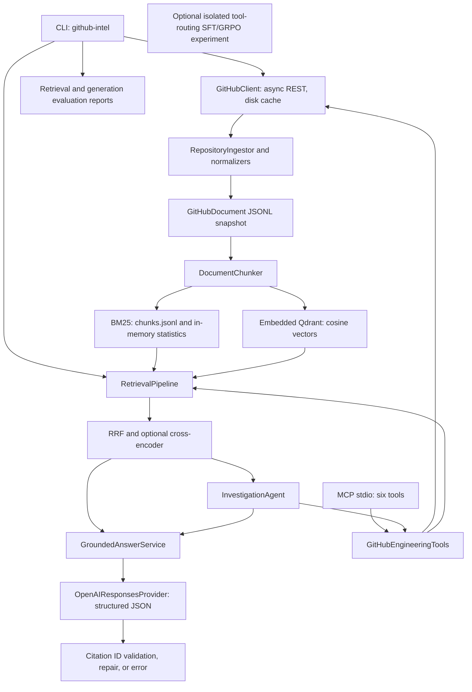
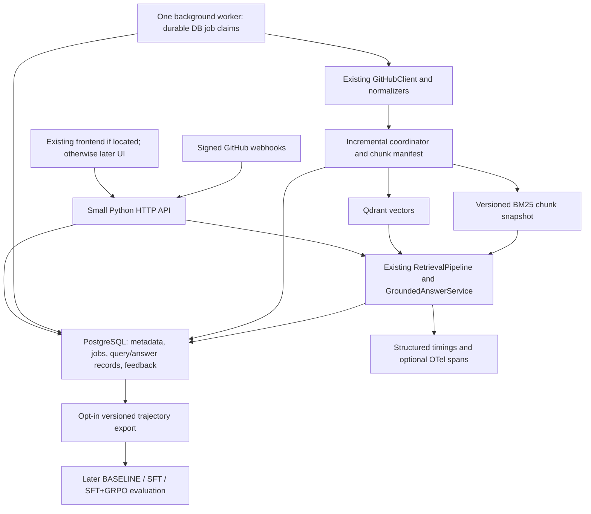

# Productionization plan — repository audit

Audit date: October 5, 2026. The Phase 0 audit below is retained as the design
record. The user separately approved Phases 1–5, now implemented; their
implementation/verification records appear at the end. The numbered roadmap is paused.
A separate CI-only approval is implemented below; Phase 6 and later remain unapproved.
Frozen evaluation data, retrieval settings, and benchmark numbers are unchanged.

## Scope and working-tree state

Inspected the Python package, all test modules, configuration, dependency manifests,
CLI/MCP entry points, ingestion/retrieval/generation/agent/post-training modules,
dataset inventories, README, local evaluation reports, and filesystem/deployment
inventory. No AGENTS.md was found. The nested `github-engineering-intelligence-rag/`
directory is empty.

Pre-existing changes: `.gitignore`, `README.md`, `pyproject.toml`, and
`src/github_intelligence/cli.py` are modified; `scripts/`,
`src/github_intelligence/post_training/`, `data/post_training/`, and
`tests/unit/test_post_training.py` are untracked. They are part of the audited
working tree, not changes introduced by this audit. Preserve them and agree on
ownership before staging implementation commits. `.env` was not read.

The described HTTP API and Next.js/React frontend are **absent from this checkout**.
There is no package.json, frontend source, HTTP application, Dockerfile, Compose
file, migration directory, deployment manifest, or `.github/workflows` configuration.
FastAPI in corpus records is an indexed repository, not this application's backend.
Starlette/uvicorn in the dependency snapshot do not establish an application API.
Confirm the location of any separately maintained frontend/API before implementing
replacement product surfaces.

## Current architecture



All code paths below are relative to `src/github_intelligence/` unless specified.

| Area | Actual implementation | What exists / important limits |
| --- | --- | --- |
| Entry points | `cli.py:main`, `build_parser`; pyproject scripts | `ingest`, `index`, `search`, `ask`, `investigate`, retrieval/generation evaluation, policy preparation/training/evaluation. No product HTTP API. |
| Configuration | `config.py:Settings` | Pydantic environment/.env settings, hidden secret repr, validated chunk overlap, model/candidate/tool limits. No DB, webhook, worker, remote Qdrant settings. |
| GitHub transport | `github/client.py:GitHubClient` | Async httpx, pagination, ETag/TTL cache, timeout, bounded transport/5xx retries with exponential jitter, basic primary rate-limit handling. |
| Cache | `github/cache.py:DiskCache` | Atomic JSON-file replacement; response cache, not application state. Cache key lacks credential identity, a future private-repository isolation concern. |
| Ingestion | `ingestion/service.py:RepositoryIngestor.ingest` | Issues, issue comments, PRs, PR conversation and inline review comments, commits, releases, documentation. Sequential full enumeration; yields documents. No persisted job, checkpoints, reconciliation, or incremental cursor. |
| Normalization | `ingestion/normalizers.py` | Shared normalizers preserve URLs, GitHub IDs, timestamps where supplied, source types, author and source-specific metadata. Documentation uses blob SHA as github_id and path in metadata. Commit ingestion stores messages, not implementation diffs. PR review bodies are not fetched from `/reviews`. |
| Canonical models | `models/document.py:GitHubDocument`, `models/retrieval.py:DocumentChunk`, `RetrievalResult` | Strict Pydantic contracts; ranking diagnostics survive fusion. No content hash, index version/status, persistent repository foreign key. |
| Chunking | `retrieval/chunking.py:DocumentChunker.chunk` | Heading-aware documentation, conversation context, word bounds/overlap. UUID5 chunk IDs derive from repository, github_id, and ordinal; source type is omitted. |
| Lexical retrieval | `retrieval/bm25.py:BM25Retriever` | Custom BM25, k1=1.5, b=0.75; persistent chunk JSONL, in-memory corpus statistics. `index()` replaces all chunks with a non-atomic write. Repository filtering occurs after scoring using global corpus statistics. |
| Vector retrieval | `retrieval/vector.py` | Lazy normalized MiniLM embeddings; `QdrantVectorStore` opens embedded path storage. `replace()` deletes/recreates the entire collection; `QdrantVectorRetriever.index()` embeds every chunk. No per-document update/delete. |
| Fusion/reranking | `retrieval/pipeline.py:RetrievalPipeline.search`, `fusion.py:reciprocal_rank_fusion`, `reranker.py:CrossEncoderReranker` | Four modes, stable fusion/deduplication and tie breaks; RRF k=60, 25 candidates/backend, 40 rerank pool. Preserve scoring and ordering. |
| Generation | `generation/service.py:GroundedAnswerService`, `provider.py:OpenAIResponsesProvider` | Retrieve once or generate from supplied evidence; strict DraftAnswer schema, timeout, store=false, bounded citation repair. No evidence skips provider and abstains. Provider has no transient retry policy and drops usage metadata. |
| Citations/evaluation | `generation/service.py:validate_draft`, `generation/evaluation.py:evaluate_grounded_answer` | IDs must exist and inline/declarations match. URLs supplied by app. Uncited answer allowed with a limitation. Validation proves reference membership, not semantic support for every claim. Groundedness/coverage are deterministic lexical/sentence proxies. |
| MCP | `mcp/server.py:create_mcp_server`, `mcp/tools.py:GitHubEngineeringTools` | Six read-only typed tools: search_issues, get_issue, search_pull_requests, get_pull_request, get_release, search_repository_documents. Shared tool implementations with the agent; no rewrite needed. |
| Agent | `agent/workflow.py:InvestigationAgent.investigate`, `planner.py:InvestigationPlanner` | Rule-based planning, bounded tools/steps/evidence, URL deduplication, follow-up retrieval, public trace. Initial retrieval errors propagate. Later tool errors become explicit limitations and may still allow an answer from existing evidence. |
| Observability | `logging.py:configure_logging` | Structured JSON stderr logs and some GitHub/ingestion events. No stage timings, query correlation, token/cost accounting, tracing exporter, dashboard or persisted query records. |
| Evaluation | `evaluation/evaluator.py:RetrievalEvaluator`, `generation/benchmark.py:GenerationEvaluator` | Source-level deduplication and diagnostics; generation batch records failures. Retrieval depth is chunk top-k before source deduplication: do not change this silently. CLI writes reports but does not enforce quality thresholds. |
| Post-training | `post_training/{models,dataset,reward,formatting,evaluation,training}.py` | Existing isolated next-tool policy interface, repository-disjoint splits, SFT/GRPO TRL/LoRA code and local CUDA experiment shell script. Not a full answer trajectory or deployed learned policy. No Modal integration. |
| Application persistence | None | Corpus JSONL and cache/index files persist data; embedded Qdrant's internal SQLite is not an application relational store. No users, ownership, queries, answers, feedback, jobs, migrations. |

## Verification and benchmark protection

Commands run with the existing `.venv` (Python 3.11.0):

| Check | Observed result |
| --- | --- |
| `.venv/bin/pytest` | 71 passed in 1.34 seconds |
| `.venv/bin/ruff check .` | Passed |
| `.venv/bin/mypy src` | Passed; 48 source files |
| `.venv/bin/ruff format --check .` | Failed; 22 files need formatting, 44 already formatted. Existing debt, left unchanged. |
| `git diff --check` | Passed before audit document creation |

Tests reside under `tests/unit/`. They cover BM25 persistence with real temporary
files; cache serialization; MockTransport pagination/cache; normalization; chunking;
fusion; simulated vector/encoder and reranker behavior; generation repair/abstention;
MCP schemas, evidence deduplication and limits; metric aggregation; policy datasets,
serialization, splits and rewards. The named Qdrant unit test uses FakeVectorStore,
not a real Qdrant integration. No PostgreSQL, HTTP, webhook, job, concurrency,
rate-limit/backoff, real index mutation, or retrieval-outage integration coverage.

Verified frozen v2 snapshot: 892 documents, 1,356 default chunks, 54 queries
(18 per repository), all labels resolve. Types: 41 issues, 300 PRs, 300 commits,
251 releases. **No comments or documentation in this snapshot**, despite ingestion
support. Add a separate integration fixture; do not alter this benchmark to cover them.
README's 74 labels correspond to 74 distinct repository/source pairs across 75
query-label entries; this is a terminology clarification, not missing data.

Recorded baseline in README and local `output/retrieval-evaluation-v2.json`:

| Mode | Recall@10 | NDCG@10 |
| --- | ---: | ---: |
| BM25 | 0.8225 | 0.7032 |
| Vector | 0.8889 | 0.7836 |
| Hybrid | 0.9352 | 0.8123 |
| Hybrid + reranker | **0.9352** | **0.8203** |

Local `output/generation-evaluation.json` records 9/9 successful generations and
citation validity 1.0, coverage 0.5413, lexical groundedness 0.4770. These are
historical results, not proof of general answer correctness. Paid generation was
not rerun during this audit. `output/` is ignored, so CI cannot rely on these local
reports being available after cloning.

Frozen file SHA256 values for future baseline manifests:

- `data/corpus/benchmark_v2.jsonl`: `b68241afbdb52b8536bc926a30deca9049cd1a703d1e6674d4c4bbd1d313162e`
- `data/eval/retrieval_v2.jsonl`: `2bf0c1871b6c24c39f945cb40e2ffda954d07889eb343a1739c5818087a4057f`

Existing reproduction commands (index is destructive to configured stores; use
dedicated benchmark paths, never a live application index):

```bash
INDEX_DIR=.cache/benchmark-index QDRANT_PATH=.cache/benchmark-qdrant \
  github-intel index data/corpus/benchmark_v2.jsonl
INDEX_DIR=.cache/benchmark-index QDRANT_PATH=.cache/benchmark-qdrant \
  HF_HUB_OFFLINE=1 github-intel evaluate-retrieval \
  --dataset data/eval/retrieval_v2.jsonl --top-k 10 \
  --output output/retrieval-evaluation-v2.json
github-intel evaluate-generation --dataset data/eval/generation.jsonl \
  --output output/generation-evaluation.json
```

Audit reproduction used temporary copies of the existing verified chunk file and
Qdrant directory, with `_env_file=None`, default benchmark settings and offline
model loading. It completed successfully and reproduced every reported metric
exactly for all four retrieval modes, including Recall@10 0.9351851851851852 and
NDCG@10 0.8202829598118297 for hybrid_rerank. The temporary report is at
`/var/folders/bz/0hxb6pn92jg8ppzbh4swm4rm0000gn/T/github-intel-audit-e2eo79i3/retrieval-report.json`.
The process exited with code 0 but emitted a Qdrant destructor warning at Python
shutdown (`sys.meta_path is None`). Add explicit client close/lifecycle ownership
when introducing the shared runtime; the completed metrics were unaffected.

## Architectural debt and conflicts

1. **Frontend/API mismatch:** none exists locally. Start with persistence, not an
   invented frontend replacement; establish whether other code lives elsewhere.
2. **Full replacement vs incremental writes:** `cli.py:run_index` writes BM25 first,
   then vectors. Failure can expose mismatched indexes, and indexing one repository
   replaces other repositories. Keep explicit snapshot indexing for benchmarks;
   introduce a separate incremental coordinator for application ingestion.
3. **Identity:** blob SHAs change with content and can be identical for different
   paths. Repository+github_id+ordinal chunk IDs omit source type and path. Persist
   stable typed document identity (documentation by branch/path) and mapping to
   legacy chunk IDs. Do not globally change IDs before regression verification.
4. **Deletion safety:** max-pages limits, truncated trees, failed requests and disabled
   source families mean absence is not proof of deletion. Track scan completeness
   by source family; only reconcile deletions for completed authoritative scopes.
5. **Consistency/concurrency:** DB, Qdrant and lexical files cannot share a SQL
   transaction. Embedded Qdrant is inappropriate for independent API/worker
   processes opening the same path. A long-lived API BM25 instance also needs
   explicit index refresh. Plan replayable indexing and a publication/readiness
   boundary; do not label a document indexed after only one backend succeeds.
6. **GitHub freshness/reliability:** current TTL can hide webhook edits; bypass or
   invalidate affected endpoints. Secondary 403 rate limits/Retry-After are not
   fully handled. Documentation tree SHA and content fetched from a moving branch
   can diverge; fetch an immutable revision. Truncated trees only log a warning.
   CLI JSONL writes can leave a partial file after a source failure.
7. **Failure semantics:** direct retrieval exceptions propagate, but missing vector
   collections return empty results and hybrid can use BM25 alone. Missing BM25
   files also appear empty. Distinguish healthy no-match, partial evidence, index
   unavailability and not-yet-indexed repository at the application boundary.
   Do not invent a fallback answer on infrastructure failure.
8. **Security:** no auth/ownership contract. Private repository cache and retrieval
   need access boundaries before exposure. Avoid logging raw query/evidence,
   provider response bodies or unsanitized exceptions by default. GitHub tokens
   currently stay in headers, not intentional logs; this is not a comprehensive
   redaction guarantee. Never store tokens in document/repository metadata.
9. **Coupling/duplication:** `mcp/server.py:main` imports pipeline construction from
   cli.py. Future API/worker should share a small runtime factory. Repeated JSONL
   loaders and independent reward calculations exist; consolidate deliberately,
   not as an audit rewrite. Ingestion and MCP already share normalizers/tools.
10. **RL scope:** existing rewards are fixed: `formatting.py:completion_reward`
    uses 0.4 schema + 0.6 routing, while `reward.py:evaluate_policy_action` uses
    different evidence/tool weights and penalties. They measure different things.
    Version these pilot definitions rather than presenting them as validated
    answer rewards. Policy training derives examples from the retrieval dataset;
    those trained policies cannot claim the full 54 queries are untouched policy
    holdouts. Preserve repository-disjoint policy evaluation and separate it from
    frozen-retriever regression testing. No training was executed in this audit.
11. **Reproducibility:** model names are recorded but revisions aren't pinned;
    requirements.lock predates optional RL changes and should not be regenerated
    casually. Package version 0.6.0 differs from `__init__.__version__` 0.1.0.

## Proposed end-state architecture (Phase 0 design)

One Python application with shared ingestion/retrieval/generation services; one
PostgreSQL database for application state; Qdrant for vectors; existing BM25 for
lexical retrieval. Once API and ingestion worker are separate processes, use one
Qdrant server rather than concurrent embedded clients. This is a storage boundary,
not a microservice rewrite. No Redis/Kafka/Kubernetes is needed for the current scope.



### Smallest Phase 1 implementation for approval

Add an **optional persistence package**, SQLAlchemy 2 typed models, psycopg and
Alembic migrations. Keep current CLI/MCP/retrieval usable without DATABASE_URL;
no database writes on import, no implicit create_all, no changes to ranking or
existing JSONL models. Use synchronous sessions to match current synchronous
retrieval/generation; later HTTP routes must offload blocking work appropriately.

Create seven application tables with UUID keys, explicit UTC timestamps, foreign
keys, indexes, checks and unique constraints:

| Table | Minimum proposed fields and invariants |
| --- | --- |
| User | id, optional external identity (unique when supplied), created_at. No password/OAuth implementation in this phase. |
| Repository | id, provider GitHub ID when known, canonical owner/name, URL, default branch, visibility, nullable owner_user_id for local public mode, timestamps. Single-owner scope initially; multi-user sharing requires later membership/access design. |
| Document | id, repository_id, source_type, stable source_key, github_id, github_url, title, author, source timestamps, commit_sha, content_hash, embedding_version, index_status, metadata, last_seen_at, deleted_at. Unique(repository_id, source_type, source_key). Store one canonical normalized payload for later reindex/recovery; retain GitHubDocument compatibility at the adapter boundary. |
| IngestionJob | id, repository_id, optional requesting user, operation/scope, idempotency key, lifecycle status, progress counts, attempts, timestamps, sanitized error code/detail. Unique scoped request key; lifecycle validation in service plus SQL allowed-value checks. |
| Query | id, repository_id, optional user_id, request/correlation key, status, model/provider, config/version, timing/usage metadata, optional query text subject to retention policy. No raw text by default. |
| Answer | id, query_id, attempt/status, optional stored answer text, citations/source references, citation validation outcome, limitations, created_at. Multiple attempts explicitly numbered; unique(query_id, attempt). Do not duplicate retrieved source bodies. |
| Feedback | id, answer_id, optional user_id, positive/negative, optional constrained category, created_at. Permit anonymous local feedback without claiming authenticated identities; later API defines edit/dedup semantics. |

Keep document identity/hash helpers separate from DB sessions. Canonically hash
normalized retrieval content and relevant metadata with a versioned serialization;
exclude ingestion time/status so repeated imports are no-ops. Treat embedding/model
and chunker versions separately from content. Stable documentation source_key uses
path/branch, while github_id remains the observed blob SHA. Do not change legacy
DocumentChunker IDs during Phase 1.

Expose small operations for repository registration, normalized-document upsert
and job/query/answer/feedback records with caller-owned transaction boundaries.
No generic repository framework. Demonstrate persistence through an explicitly
opt-in `import-metadata` CLI command for existing JSONL: validates all documents,
registers repository identities, upserts by stable key, reports new/changed/unchanged,
and leaves index_status pending. It does **not** claim vectors have been updated.
No GitHub token or model key is stored. No existing command requires PostgreSQL.

Acceptance: migrations work against real temporary PostgreSQL; downgrade/re-upgrade
on disposable DB; FKs/checks/unique constraints enforced; rollback works; duplicate
imports are no-ops; changed documents update one row; DB failures surface; secrets
excluded; existing 71 tests/lint/types and retrieval baseline remain intact.
Pure helper tests can be fast; SQL behavior tests must use PostgreSQL, not mocked
sessions or SQLite as evidence of PostgreSQL correctness.

Expected files (proposal only):

- Modify `pyproject.toml`, `requirements.lock` after resolving the new optional
  dependencies, `.env.example`, `src/github_intelligence/config.py`,
  `src/github_intelligence/cli.py`, `README.md`, this plan.
- Create `alembic.ini`, `migrations/env.py`, `migrations/script.py.mako`,
  `migrations/versions/0001_application_state.py`.
- Create `src/github_intelligence/persistence/{__init__,database,models,operations,identity}.py`.
- Create `tests/unit/test_document_identity.py`,
  `tests/integration/{conftest,test_persistence,test_migrations}.py`.
- Create `compose.yaml` for a local PostgreSQL service only, with an explicit
  disposable-test database configuration. A full deployment stack waits.

Do not add HTTP routes, a worker, remote Qdrant, webhooks, a frontend, or training
jobs in this initial change. The database schema prepares those subsequent steps.

## Migration and implementation phases

Each phase is independently reviewable; update README to distinguish implemented
from planned features and record meaningful checks at each step.

1. **Persistent state:** implement the approved Phase 1 slice above. Import copies
   of JSONL metadata; preserve corpus snapshots and application/benchmark isolation.
2. **GitHub ingestion hardening:** extend GitHubClient and RepositoryIngestor,
   not replace them. Add repository metadata, full PR review bodies if useful,
   bounded Retry-After/secondary-limit handling, immutable documentation fetches,
   scan completeness and per-source checkpoints. Test real normalization and
   HTTP boundary behavior with controlled transports, including backoff exhaustion.
3. **Incremental coordinator:** new/changed/unchanged/deleted detection, explicit
   manifest of document-to-chunk IDs and versions, Qdrant upsert/delete, selective
   embedding. Preserve BM25 formula; update canonical chunk membership and global
   statistics, atomically publish refreshed snapshots. Rebuilding cheap BM25
   statistics is acceptable; re-embedding all documents is not. Do not change
   corpus population/scoring rules merely to simplify updates.
   Use per-repository serialization and a persisted indexing operation/revision
   record to replay after crashes; publish readiness only after both backends
   agree, with readers rejecting an in-progress/inconsistent scope. Document
   eventual recovery rather than claiming cross-store transactions. Test shrinkage,
   deletes, collisions, no-op repeat runs and every partial-failure boundary.
4. **Durable jobs and HTTP API:** one worker claims PostgreSQL jobs with leases,
   bounded retries and recovery after restart; no in-process fire-and-forget tasks
   as the durable queue. QUEUED → FETCHING → PARSING → EMBEDDING → INDEXING →
   COMPLETE; any active stage may become FAILED. Define resumable retries and
   no-op stage handling, progress and sanitized failure endpoints. Add repository,
   ingestion-job creation/status and query endpoints. Use server Qdrant for shared
   access and explicit BM25 refresh. Locate existing UI first; add progress later.
5. **Webhooks:** verify raw-body HMAC before parsing or enqueueing; enforce delivery
   uniqueness in DB, acknowledge only persisted work. issues, issue_comment,
   pull_request, pull_request_review and push map to targeted document scopes;
   also consider pull_request_review_comment for existing inline sources. Handle
   deletions, out-of-order events and repository authorization. Duplicate delivery
   and duplicate content remain idempotent. Periodic authoritative reconciliation
   covers missed deliveries without a full vector rebuild.
6. **Observability:** instrument RetrievalPipeline, reranker, provider, answer
   service and agent tools with query IDs, timings, counts, statuses and optional
   OTel-compatible spans. Persist metadata, not raw prompts by default. Extract
   actual token usage; estimated cost only with versioned explicit price inputs,
   otherwise null. Unknown usage/cost is never reported as zero. Later dashboard
   reads aggregates; no dashboard platform dependency required initially.
7. **Reliability:** typed boundary errors, bounded retry/timeouts, sanitized logs,
   liveness/readiness checks, explicit evidence-unavailable/insufficient states.
   Preserve fail-closed citation repair. A partial tool failure with healthy existing
   evidence must be explicitly represented; retrieval infrastructure failure must
   not silently become a successful fabricated answer. Test these distinctions.
8. **CI and quality gates:** introduce GitHub Actions because no workflow exists.
   Lint, format (resolve existing 22-file debt in a separate review), strict types,
   unit tests, real PostgreSQL/Qdrant integration, frozen retrieval regression.
   Cache pinned model revisions; archive diagnostics/config/data hashes.
   Proposed configurable absolute tolerances: 0.01 Recall@10 and 0.02 NDCG@10
   against hybrid_rerank baseline 0.9352/0.8203 (minimum 0.9252/0.8003).
   These are starting engineering tolerances, not statistical significance claims:
   they allow small ranking/numeric variation while rejecting meaningful aggregate
   drift. Gate hybrid mode too using its own baseline; require 54 queries and
   matching frozen dataset/corpus/config. Review per-query changes even on pass.
   Do not weaken thresholds to mask regressions. Retrieval CLI currently always
   returns success after evaluation, so add a gate wrapper/nonzero result.
   Keep paid generation evaluation opt-in/scheduled; deterministic citation tests
   belong on every PR. Resolve dependency/model pinning before claiming reproducibility.
9. **Feedback:** expose positive/negative and incorrect_answer, bad_sources,
   missing_context, unsupported_claim, other; validate answer/repository access.
   Store answer reference/category, not duplicated question/context; define request
   deduplication, retention and update semantics. Provide failure-mode aggregates.
10. **Training preparation only:** adapt existing post_training schemas and agent
    output; do not create a competing policy system. Add requested
    `training/{README.md,schemas.py,rewards.py,dataset.py,evaluate.py}` as documented
    export/evaluation interfaces, sharing core contracts. Version trajectories
    with query (opt-in retention/export), available tools, public actions/tool calls,
    source IDs/versions, scores, final answer/citations, metric provenance, latency,
    usage and feedback. Missing correctness labels remain null. Configurable
    component weights are explicitly experimental; separate correctness,
    groundedness, citation validity/coverage, relevance, tool appropriateness and
    unsupported/invalid/unnecessary-call penalties. Do not conflate lexical support
    with correctness. Preserve old reward-version comparability, isolate data splits,
    record BASELINE/SFT/SFT+GRPO under identical runtime budgets, and report answer
    metrics separately from routing accuracy. Modal/TRL execution remains future;
    no credentials or GPU jobs.
11. **Tests alongside each change:** helper determinism, real DB constraints and
    transitions, incremental index mutations, idempotency, deletions, webhook HMAC
    and delivery deduplication, retries, retrieval failure, citation validation,
    trajectory round trips and configurable reward arithmetic. Use actual stores
    for store semantics and controlled HTTP for external boundaries.
12. **Documentation/deployment:** update README incrementally with architecture,
    pipeline, stores/jobs, incremental behavior, observability, frozen methodology
    and benchmark, gates, local development/settings/testing/deployment and future
    RL scope. Later one-host deployment: API + worker + PostgreSQL + Qdrant, durable
    volumes, migration step, backups/restore checks, health probes, secret injection
    and bounded worker concurrency. Frontend hosting choice follows actual UI
    location. Authentication/authorization and private-source retention are required
    before exposing repository data beyond a local trusted user.

## Approval boundary

Phase 0 ends with this plan and verification report. The next proposed change is
only the Phase 1 persistence slice and its opt-in JSONL import. No major
architectural changes begin until the user approves that scope.

## Phase 1 implementation and verification

The user approved this persistence slice after Phase 0. Phase 1 is implemented;
Phase 2 and later remain unapproved and unimplemented by this change.

### Delivered behavior and schema

- Optional `persistence` extra: SQLAlchemy, Alembic and psycopg. Existing CLI/MCP
  imports never load these libraries or open PostgreSQL unless metadata import
  is explicitly requested. A subprocess test blocks all three optional packages
  and verifies core CLI/MCP imports and BM25 usage still work.
- Explicit PostgreSQL-only engine, UTC sessions, 10-second connection timeout,
  30-second statement timeout, hidden SQL parameters and caller-owned transactions.
  No implicit schema creation. A standalone initial migration defines all seven
  tables, independent of future model changes.
- Tables: users, repositories, documents, ingestion_jobs, queries, answers,
  feedback. UUID primary keys and timezone-aware row timestamps; foreign keys,
  unique keys, allowed-value and progress constraints, and lookup indexes.
  Metadata stores one canonical normalized payload, not a duplicated document body.
- Document identity: UUID5 over canonical repository, source type, source key.
  Documentation keys are branch/path JSON tuples; SHA remains the observed revision.
  SHA256 normalized-v1 hashes include normalized source content/metadata/timestamps
  and omit operational bookkeeping. Existing retrieval document/chunk IDs are untouched.
- Atomic opt-in `import-metadata`: validates the entire file, registers repository
  records without inventing GitHub provider IDs, default branch or visibility,
  and reports new/changed/unchanged. Repository locks and consistent lock order
  serialize concurrent imports. Changed rows become pending and clear indexed
  versions; unchanged rows preserve all timestamps and indexed versions/status.
- Small record operations for users, jobs, queries, answers and feedback. Job
  lifecycle is validated with row locks; scoped duplicate request keys reuse the
  job, conflicting requests reject. Feedback categories are SQL-constrained.
  Query request and answer attempt uniqueness are enforced by PostgreSQL; no API
  retry/edit semantics are implied. There is no worker or automatic query capture.
- Query/answer text and free-text limitations default to omitted, with explicit
  `store_content=True` for retention. Citation/source references forbid body fields.
  Credential-bearing structured metadata keys reject; CLI/migration failures omit
  raw SQL/connection/error bodies. Source text is not a secret-scanning boundary.
- PostgreSQL-only Compose setup: application durable volume and separate optional
  test service with tmpfs, loopback-bound ports and local password environment
  inputs. No other infrastructure was added.

### Final verification

Real database: PostgreSQL 16.2, aarch64 macOS, using a temporary downloaded pgserver
runtime in ignored `.cache/pg-test-runtime` and data in `/private/tmp`. Neither
PostgreSQL nor Docker was preinstalled. pgserver is a verification aid only,
not a project dependency or deployment architecture. Docker Compose itself was
not executed on this machine; its YAML structure was inspected.

| Check | Result |
| --- | --- |
| Full existing + new suite, exported TEST_DATABASE_URL | **102 passed in 5.13 seconds**, no warnings |
| Alembic upgrade → downgrade → re-upgrade | Passed on a real isolated PostgreSQL schema, via command API and environment-driven CLI |
| `alembic check` / migration-to-model comparison | No schema drift |
| Full corpus import, then duplicate import | 892 new, then 0 new / 0 changed / 892 unchanged; 3 repositories |
| Changed document and documentation SHA update | Same row ID, new payload/hash, pending status; no duplicate document |
| Concurrent imports | One new document and one unchanged result |
| Rollback, validation, foreign keys/checks/uniqueness | Passed against PostgreSQL, including raw SQL bypassing service checks |
| `.venv/bin/ruff check .` | Passed |
| `.venv/bin/mypy src migrations` | Passed in strict mode, 55 Python files (53 package + 2 migration files) |
| Formatting of new persistence/migration/test files | Passed; unrelated existing formatting debt left untouched |
| `.venv/bin/python -m pip check` | No broken requirements |
| Frozen 54-query retrieval evaluation | All four modes and all metrics exactly match the historical report |
| Hybrid + reranker | Recall@10 **0.9352**, NDCG@10 **0.8203**, delta **0.0000 / 0.0000** |
| Frozen corpus/dataset hashes | Match Phase 0 hashes above |
| Existing CLI workflow functions | AST comparison confirms function bodies preserved outside parser/dispatch additions |

The offline evaluation used temporary copies of existing benchmark indexes,
default frozen settings, no `.env` or PostgreSQL, and cached models. The report is
`output/phase1-retrieval-evaluation.json` (ignored generated artifact). Explicitly
closing its temporary Qdrant client avoided the audit's shutdown warning without
modifying retrieval runtime code. Paid generation and GPU training were not run.

### Files created or modified by Phase 1

Created:

```text
alembic.ini
compose.yaml
migrations/env.py
migrations/script.py.mako
migrations/versions/0001_application_state.py
src/github_intelligence/persistence/__init__.py
src/github_intelligence/persistence/database.py
src/github_intelligence/persistence/identity.py
src/github_intelligence/persistence/models.py
src/github_intelligence/persistence/operations.py
tests/unit/test_document_identity.py
tests/integration/conftest.py
tests/integration/test_migrations.py
tests/integration/test_persistence.py
```

Modified:

```text
.env.example
README.md
docs/productionization-plan.md
pyproject.toml
requirements.lock
src/github_intelligence/cli.py
src/github_intelligence/config.py
```

The earlier modified `.gitignore`, untracked post_training/data/scripts/test work,
and existing portions of README/pyproject/CLI remain preserved. No commits or
staging were performed. Temporary dependency/runtime files and verification output
are ignored local artifacts, not deliverable source files.

### Clarifications, limitations and remaining debt

No scope expansion into Phase 2. Two schema naming/storage clarifications:
document source timestamps use `source_created_at`/`source_updated_at` to separate
them from row timestamps; source metadata stays in `normalized_payload.metadata`
rather than duplicating it in a second JSON column. `chunker_version` is tracked
separately from embedding_version, as approved in the identity design. Versions
remain null until a later indexing implementation actually sets them.

For true no-op repeated imports, last_seen_at is not refreshed for unchanged rows;
it currently means the last metadata-changing observation. Later deletion
reconciliation must introduce scan completeness/epochs rather than treating this
timestamp as proof an unchanged object was not seen. Metadata import never infers
deletions. Documentation URL-derived refs can be commit revisions rather than
branches; callers with branch semantics should supply metadata.branch/ref. GitHub
branch discovery and immutable content fetches remain Phase 2 work.

Imports currently validate/materialize the entire JSONL and hold one transaction
with repository locks. This is deliberate at the measured corpus scale; bounded
batching/checkpoints belong to later ingestion work. Job rows have no queue worker,
leases or restart recovery yet. Query/answer/feedback operations are available to
future callers; existing ask/investigate do not automatically persist user content.
Authentication, private-repository access, deletion policies, automatic indexing,
observability and HTTP surfaces remain planned. No production-readiness claim is
made merely from introducing tables.

The environment needed elevated local socket access to verify PostgreSQL because
the sandbox blocks Unix socket connections. Tests use a dedicated database name
containing `test` and random schemas; no existing application database was touched.
Existing global formatting debt and dependency/model revision pinning debt remain.

Stop after Phase 1. Phase 2 requires separate user approval.


## Phase 2 implementation and verification

Phase 2 was separately approved and is implemented. The earlier audit and Phase 1
sections are historical records. At completion of Phase 2, Phase 3 and later had not begun.

### Implemented boundaries

`GitHubClient` now uses explicit bounded retries with typed, sanitized failures.
Retry-After supports seconds and HTTP dates; primary reset deadlines and secondary
rate/abuse limits are honored. Server-required delays above the configured wait budget
produce deferred failures, never an early retry. Same-origin redirects and pagination
links are validated. Cache namespaces include a one-way digest of API origin and
credential identity, ignore the old shared cache, and restrict cache file permissions.
Fresh ingestion revalidates ETags; fresh 304 responses cannot silently preserve stale
pagination navigation. Tokens and raw error payloads are never logged or persisted.

`RepositoryIngestor` retains the existing normalizers and document format, adding
stable native repository identity and typed source keys. It resolves the branch head
once, enumerates commits against it, discovers documentation by immutable tree SHA
and fetches content by blob SHA. Branch/path identity stays separate from the observed
blob SHA. Full PR review summaries use their own source type; conversation and inline
review comments retain their existing representation. Empty summaries remain observed
membership without becoming empty documents.

`publish_snapshot` streams into a restrictive temporary file and publishes only after
successful enumeration and completeness validation. Reports contain a snapshot SHA256;
`load_snapshot_report` checks the report and actual JSONL together. Report publication
precedes the final data rename. This is not a two-file transaction: interruption between
renames causes a checksum mismatch that readers must reject. Normal source failures
preserve prior successful output and produce a separate diagnostic failed-scan report.
`--allow-incomplete` explicitly permits limited/truncated snapshots, never failed scans.
No database-backed scan coordinator, index mutation or deletion logic was added.

### Contract available to Phase 3

| Metadata | Guarantee and limit |
| --- | --- |
| Repository | Native GitHub ID, canonical/requested names, URL, default branch, visibility and available creation/update times; observed head/tree SHAs |
| Documents | Existing source type and GitHub ID, stable typed source key, repository GitHub ID, URL, author, available timestamps, source-specific metadata; docs retain branch/path/blob/commit SHA |
| Family scans | COMPLETE, LIMITED, TRUNCATED, FAILED or NOT_STARTED; explicit reason, requested scope, counts and observed source keys including empty/omitted objects |
| Pagination checkpoints | Endpoint/parameters, fetched page/item counts, last/next page hints, last native ID, available maximum source timestamp and scan times |
| Report | Version, scan ID, start/finish times, requested families, fresh/cache mode, configured limits, best-effort consistency, checksum and sanitized typed failure details |

A family is complete only for its recorded scope. Excluded families cannot establish
repository-wide completeness. Parent limitations propagate to dependent comment/review
families. Duplicate objects seen during mutable pagination mark a family limited.
GitHub issues and PRs are mutable offset-based lists: even COMPLETE is best-effort
enumeration, not snapshot isolation. Page numbers and timestamp high-water marks are
observations, not guaranteed resumable cursors. Phase 3 must validate publication,
inspect scopes and completeness, and apply an explicit deletion/reconciliation policy.
Absence alone must not trigger deletion. Checkpoints are sidecar metadata, not durable
worker leases or database checkpoints.

### Narrow migration and remaining debt

Full review bodies require `pull_request_review` in the existing document constraint.
Migration `0002_review_source` changes only that constraint; metadata import prefers
observed commit SHA over documentation blob SHA. Downgrade refuses while review rows
exist and preserves data/version transactionally. This necessary compatibility change
is the only Phase 1 persistence extension; no new tables or coordinator were added.

Empty repositories without a resolvable default-branch commit fail clearly rather
than publishing a misleading full snapshot. Revision validation currently assumes
GitHub's 40-character SHA format. Legacy chunk IDs and their cross-source collision
risk remain unchanged for Phase 3. Existing optional policy-training tool routing does
not yet map the new review source type; its frozen workflows/corpus remain unchanged.
No live GitHub integration was exercised: HTTP boundary tests use controlled transports.
The existing unrelated formatting debt remains untouched.

### Verification

- Full original and new suite with disposable PostgreSQL: **136 passed in 8.09s**.
- Ruff: passed. Strict MyPy: passed across **59 files**.
- PostgreSQL tests verify migrations, downgrade/re-upgrade, review-row downgrade
  refusal, duplicate metadata import no-ops and changed document updates.
- Controlled HTTP and filesystem tests cover retries/rate limits/exhaustion,
  pagination/truncation, completeness/checkpoints, immutable docs, review normalization,
  cache isolation/freshness, failed scans, atomic rename interruption and checksum rejection.
- Frozen 54-query benchmark: Recall@10 **0.9351851851851852**, NDCG@10
  **0.8202829598118297**; rounded **0.9352 / 0.8203**, exact zero delta.
  All four retrieval modes reproduced every metric. Corpus/evaluation hashes and
  retrieval/evaluation/generation/MCP/agent/post-training modules are unchanged.

Stop after Phase 2. Phase 3 requires separate user approval.


## Phase 3 implementation and verification

Phase 3 was separately approved. The existing full-snapshot `run_index`, retrieval,
generation, MCP and post-training modules remain unchanged. This phase adds only
an opt-in incremental application coordinator, its storage boundaries, migration,
tests and documentation. No API, worker, webhooks, dashboard, CI/CD, frontend or
training execution was added.

### Schema and algorithm

Migration `0003_incremental_index` adds three tables:

- `index_operations`: repository, idempotent request key, previous revision, lifecycle,
  configuration, validated scan report, prepared document plan, counts/preservation
  reasons, lexical checksum, attempt count and sanitized failure stage/code.
- `chunk_manifests`: explicit operation/document identity/typed source membership,
  ordinal, chunker and embedding versions, immutable chunk ID, payload/hash.
- `index_heads`: one repository → last published READY operation pointer.

Prepared manifest identities refer to existing or deterministic Phase 1 document IDs;
they have no document FK because new canonical records are not committed until READY.
Operation/repository references have FKs. Canonical source records retain Phase 1 hashes
and statuses; deleted documents become tombstones, not erased audit records.

`IncrementalCoordinator.run` validates the checksum pair again after reading bytes,
repository native identity, schema/families, document membership/counts, source keys
and documentation scope. It rejects stale scans and altered reports on replay. A
PostgreSQL session advisory lock serializes one repository across progress commits;
repository renames/native-ID conflicts fail explicitly. Different repositories have
separate publication pointers, manifests and lexical snapshots.

`planner.prepare_plan` combines persistent active documents with the prior READY plan.
It classifies incoming hashes as new/changed/unchanged and applies deletion policy only
to absent sources. Previously imported but never indexed records receive their first
manifest even if their metadata hash is unchanged. Unchanged published documents with
matching versions reuse exact manifests without chunking or embedding. Changed/new
documents alone use the existing chunker's text splitting. Application identity version
`application-chunk-v1` uses repository UUID, source type/key, ordinal, payload SHA256,
embedding version and chunker version. Content-versioned IDs prevent pending writes
from overwriting a point still used by a published revision. Legacy frozen IDs remain
unchanged. Identical text uses a prior same-version vector when available; only missing
text is encoded. Metadata changes can require a new immutable payload point without
requiring a new embedding.

`IncrementalVectorStore` extends the existing adapter without altering `replace()`.
It provides real Qdrant upsert, delete, lookup and exact-membership search. It never
recreates the collection for a document change. The application adapter rejects
inherited full replacement and unrestricted search; callers must use READY membership. `publish_lexical` writes/fsyncs a
revision-specific temporary chunk file, atomically renames it and fsyncs its directory.
`BM25Retriever` loads this canonical file and uses the existing scoring/statistics code;
application scope is one repository. No vector rebuild accompanies lexical publication.

### Publication and recovery

Lifecycle: PREPARING → VECTOR_WRITES → LEXICAL_BUILD → VERIFYING → READY. Exceptions
persist FAILED plus the failed stage when PostgreSQL remains reachable. A process crash
can leave the last committed intermediate stage; that is replayable too. The entire
prepared plan and manifest commit before external writes. Vector writes are immutable
and idempotent; retries check existing membership and write only missing points.
Lexical build is replayable at the operation's fixed path. Both payload membership and
lexical contents/checksum are verified before readiness publication.

Canonical document updates/tombstones, operation READY and `index_heads` move in one
PostgreSQL transaction after verification. This deliberately postpones canonical metadata
updates until publication: the persisted prepared plan represents pending metadata.
A concurrent metadata import changes the baseline fingerprint and aborts publication
rather than overwriting newer metadata. Retire that obsolete plan before preparing a
fresh scan. There is no transaction spanning PostgreSQL, Qdrant and files; unpublished
artifacts may survive failure, but readers pin the last READY manifest and cannot see
those artifacts. READY readers reject missing lexical files/checksum mismatch and
missing or inconsistent vector payloads. They must use `ready()`, never the raw collection.

| Interruption | Replay / reader behavior |
| --- | --- |
| Prepared DB manifest, failed vector write | Existing READY remains unchanged; retry fills missing immutable points |
| Partial vector batch or vectors written, failed lexical build | Existing READY filters out new points; retry reuses completed points |
| Lexical built, failed verification/publication | New file remains unpublished; previous pointer is unchanged |
| Canonical updates flushed, readiness transaction fails | PostgreSQL rolls metadata/pointer back together; retry verifies and republishes |
| Process exits without cleanup | Connection releases advisory lock; committed intermediate operation resumes |
| Partial physical stale-vector deletion | RETIRING records incomplete GC; replay deletes the remaining known unprotected IDs |

Physical stale-point deletion is intentionally deferred while old revisions are usable.
Current membership removes stale/deleted chunks immediately; `retire-index` reclaims a
non-current revision only after its readers have drained. It refuses current READY,
protects IDs referenced by other live operations and retains audit manifests. RETIRING
→ RETIRED makes partial deletion replayable. A failed pending revision can also be retired
if its baseline is obsolete. This explicit retention boundary replaces unsafe immediate
physical deletion; no automatic GC or reader lease infrastructure was introduced.

### Deletion policy

Reconciliation is disabled by default. `--reconcile` only approves absent documentation
sources whose prior branch/path belongs to the same known selector scope, with a fresh
COMPLETE scan against verified-format immutable head/tree SHAs and a different observed
tree. Unknown filters, noncomplete checkpoints, duplicate observed membership, skipped
large files and scan reasons prevent authorization. An observed-but-empty/omitted source
is preserved. Conflicting membership at the same immutable tree is preserved. Each
refusal is persisted and printed. Mutable issue/PR/comment/review/commit/release scans
never authorize deletion from absence; their offset enumeration cannot establish it.
Raw JSONL without the validated matching report is rejected. READY indicates consistency
of this revision's retrieval stores, not repository-wide ingestion completeness.

An empty canonical revision is representable with zero chunks and empty search results;
no synthetic GitHub SHA is created. Phase 2 branch resolution for genuinely empty
repositories remains explicitly unindexable until ingestion obtains honest empty-repository
semantics in an approved later change.

### Operator path and limits

`index-incremental INPUT --repo OWNER/NAME --embedding-version WEIGHT_REVISION` uses
`.cache/application-index` and `application_chunks`, isolated from the frozen index.
It prints classification counts, revision/status, preserved-source reasons and incomplete
scan families. `--root` selects application storage; `--reconcile` opts into the conservative
policy. `retire-index UUID` requires the same repository/model/chunker/storage settings.
The CLI qualifies embedding identity with `EMBEDDING_MODEL`; operators must actually
pin the configured checkpoint rather than supply an unvalidated mutable version label.
The version flag records identity and does not select a remote weight revision. Both commands use
existing DATABASE_URL/chunker/model settings. No environment additions were needed.

Remaining debt/limits: embedded Qdrant permits one process per path (repository locks
are not a workaround); server-mode support remains future deployment work. READY search
uses exact ID filters and verifies membership, suitable for current scale but requiring
measurement before larger corpora. Plans/manifests duplicate canonical payloads per
revision; retirement retains DB audit data and has no automated retention schedule.
There are no reader leases; retirement requires drained readers. Cross-repository
application retrieval and repository rename migration are not implemented. Documentation
scope follows the existing schema-1 selector; unknown future filters are refused.
The existing sentence-transformers dimension API emits a deprecation warning during
benchmark indexing; it was not changed because the frozen retrieval source is preserved.
Pre-existing formatting debt and unrelated working-tree edits remain untouched.

### Verification

- Full original + new suite, disposable PostgreSQL and real embedded Qdrant:
  **166 passed in 13.75 seconds**. Includes actual child-process `os._exit` after vector writes,
  partial upsert/delete, repeated execution, old READY access, selective embedding,
  source shrinkage, deletion refusals, imports, isolated repositories and CLI behavior.
- Alembic upgrade/downgrade-to-base/re-upgrade/model alignment and environment-driven
  CLI migration checks pass against PostgreSQL 16.2 in disposable random schemas.
- Without PostgreSQL configured: **116 passed, 50 persistence-dependent tests skipped**;
  the existing subprocess test also blocks SQLAlchemy/Alembic/psycopg imports and
  verifies CLI/BM25 use. Skips are not counted as storage verification.
- Ruff passes; strict MyPy passes across **66 files** (62 package + 4 migration files).
- Frozen existing full snapshot path rebuilt **892 documents / 1,356 chunks** with
  PostgreSQL disabled, then evaluated **54 queries**. Recall@10 **0.9351851851851852**,
  NDCG@10 **0.8202829598118297**: **0.9352 / 0.8203**, exact zero delta across every
  metric in all four modes. Report: `output/phase3-retrieval-evaluation.json` (ignored).
- Corpus SHA256: `b68241afbdb52b8536bc926a30deca9049cd1a703d1e6674d4c4bbd1d313162e`.
  Evaluation SHA256: `2bf0c1871b6c24c39f945cb40e2ffda954d07889eb343a1739c5818087a4057f`.

### Phase 3 file manifest

Created: `src/github_intelligence/indexing/__init__.py`, `coordinator.py`, `models.py`,
`planner.py`, `policy.py`, `storage.py`; `migrations/versions/0003_incremental_index.py`;
`tests/integration/test_incremental_indexing.py`; `tests/unit/test_incremental_storage.py`.
Modified: `src/github_intelligence/cli.py`; `migrations/env.py` (register optional
indexing tables for Alembic metadata); `tests/integration/test_migrations.py` (new head);
`README.md`; this plan. No dependencies, environment settings or frozen datasets changed.

Stop after Phase 3. Phase 4 requires separate user approval.

## Phase 4 implementation and verification

Phase 4 was separately approved. This adds the trusted-local HTTP boundary and a
PostgreSQL-backed worker around the existing Phase 2/3 contracts. Phase 5 and later
remain unimplemented. Earlier phase sections describe their state at completion.

### Architecture and schema

`application/runtime.py:Runtime` constructs the shared database, GitHub client,
coordinator and existing retrieval/generation dependencies without importing CLI.
`application/api.py:create_app` handles metadata, durable enqueue, job status and
READY-only queries. `application/worker.py:Worker` is an explicit independent process;
HTTP requests never fetch GitHub or invoke ingestion in an in-process background task.
`github-intel serve` defaults to loopback and disables access logs; `github-intel worker`
runs bounded worker threads, or `--once` claims one available job.

Migration `0004_job_leases` extends the existing `ingestion_jobs` with lease owner,
expiration/heartbeat, next attempt, retry eligibility, canonical snapshot path,
actual index stage and resulting revision FK. Existing attempt/progress/status/time
fields are reused. No second queue/table or broker was introduced. The other document,
manifest, operation, READY head and query/answer models retain their Phase 1–3 roles.

`application/jobs.py:claim` locks eligible rows with PostgreSQL SKIP LOCKED, commits a
unique lease grant, and increments attempts. Active leases cannot be stolen. Every
stage mutation/heartbeat checks ownership and database time. Expired work can be
reclaimed; attempts are bounded even after repeated crashes. Public lifecycle is
QUEUED/FETCHING/PARSING/EMBEDDING/INDEXING/COMPLETE/FAILED. Phase 2 fetch/normalization
is combined; PARSING validates the published snapshot; `index_stage` exposes actual
coordinator progress. Counts describe normalized documents, not estimated percentages.

### Recovery, retry and publication

A worker fetches a fresh Phase 2 scan into a grant-specific temporary directory.
Only a valid owner may publish its immutable canonical job snapshot. Recovery checks
its checksum/report pair and reuses it, including a crash before recording its path.
Incomplete ingestion is not silently indexed. Coordinator replay retains the same
operation/manifests/vector IDs. The worker checks its lease in the same PostgreSQL
transaction as READY publication and records the job's resulting revision there.
Retirement refuses a READY revision still referenced by unfinished jobs. Completing
an already-produced READY result is safe even if a newer revision became the head.

The existing cross-store states remain visible; failed attempts leave the previous
READY head usable. No distributed transaction guarantee is claimed. A reclaimed
worker encountering the old coordinator's live advisory lock defers safely.
`application/failures.py:classify` maps controlled GitHub, DB, Qdrant and contract
exceptions to sanitized categories. Transient errors are retryable; invalid scopes,
configuration, authorization and invariants are terminal. FAILED retryable jobs carry
`next_attempt_at`; polling reclaims only when due and below the attempt budget.
Exponential delay is bounded by configuration except GitHub's minimum deadline,
which must not be shortened. Defaults and overrides are in `.env.example`.
Shutdown stops new claims, cancels ongoing asynchronous fetches and waits for
synchronous work to reach a safe boundary. Native model execution is not forcibly
interrupted. An ownership/DB failure during error reporting leaves lease expiry
responsible for recovery rather than allowing an unfenced status overwrite.

### HTTP/query/storage contracts

Routes: POST /repositories; GET /repositories/{id}; POST /repositories/{id}/ingestions;
GET /ingestion-jobs/{id}; POST /repositories/{id}/query; GET /health/live and /health/ready.
Enqueue is 202 with durable idempotency; conflicting scopes are 409. Missing repository
is 404; missing READY is 409; invalid input is 422. Unavailable evidence/configuration
or retrieval infrastructure is 503; generation/citation failures are 502. Empty
retrieval is an explicit insufficient-evidence result, not an infrastructure fallback.
Raw request/provider bodies are excluded from controlled errors. Query/answer text
retention remains opt-in (`store_content`), using existing persistence operations.

Each query resolves the current READY head and loads that revision's lexical snapshot;
vector search is constrained to the exact manifest membership. The existing BM25,
RRF, reranker, grounded answer service and citation validator are reused unchanged.
Application health probes storage/schema/shared-root and provider configuration with
bounded timeouts, not external provider authentication or model quality.

`indexing/storage.py:IncrementalVectorStore` now supports an explicit server URL as
well as its existing embedded path. API/worker require server mode. URL credentials
are rejected; Qdrant keys remain only in memory/settings. Configuration identity stores
the public endpoint rather than credentials. Concurrent collection creation is verified
when another process wins. The full snapshot vector store remains unchanged.
`compose.yaml` adds a loopback-only Qdrant v1.19.2 service and persistent volume.
API/worker must share an identical durable APPLICATION_ROOT and model/chunker/storage
settings. README documents installation, migration, process startup and all endpoints.
Existing incremental/retirement CLI commands accept explicit server mode; offline
benchmark/CLI/MCP use does not require PostgreSQL or application extras.

### Verification and limitations

- Full suite with real disposable PostgreSQL 16.2 and actual Qdrant v1.19.2 HTTP server:
  **201 passed**. New tests exercise actual PostgreSQL locks/lease expiry and Qdrant
  server writes/membership. Controlled GitHub transport and deterministic model/provider
  fixtures do not claim live GitHub/provider/model-quality verification.
- Tests cover held-row SKIP LOCKED, competing claims, heartbeat, stale grants,
  different repositories, concurrent duplicate HTTP requests, API recreation,
  post-ingestion/vector/READY crash replay, actual child-process `os._exit`, old READY
  queries while indexing, lexical refresh, retries/deadlines and terminal failures,
  retention defaults, sanitized errors, invalid transitions and dependency health.
- Migration upgrade → downgrade base → re-upgrade, environment-driven Alembic CLI
  and schema/model alignment pass in disposable PostgreSQL schemas.
- Without PostgreSQL/Qdrant test configuration: **127 passed, 74 skipped**. Existing
  subprocess coverage blocks optional SQL imports and verifies offline CLI/BM25 use.
- Ruff passes. Strict MyPy passes **73 files**; new files pass Ruff formatting checks.
  Unrelated pre-existing formatting debt was preserved.
- Frozen full-snapshot indexing rebuilt **892 documents / 1,356 chunks**, with
  PostgreSQL disabled. All four retrieval modes on **54 queries** have exact zero
  metric delta from Phase 3. Hybrid-rerank Recall@10 **0.9351851851851852** and
  NDCG@10 **0.8202829598118297**, rounded **0.9352 / 0.8203**.
  Report: `output/phase4-retrieval-evaluation.json` (ignored).
- Corpus SHA256 remains `b68241afbdb52b8536bc926a30deca9049cd1a703d1e6674d4c4bbd1d313162e`;
  evaluation SHA256 remains `2bf0c1871b6c24c39f945cb40e2ffda954d07889eb343a1739c5818087a4057f`.
  Retrieval/generation/MCP/agent/evaluation/post-training source and legacy CLI
  workflow functions were compared with the Phase 4 starting snapshot: unchanged.

No scope deviations. Docker Compose could not be executed in this environment;
server semantics were instead verified using the official native macOS ARM Qdrant
binary, telemetry disabled and temporary loopback storage. A newly empty Qdrant
collection occasionally returns transient HTTP 500 during concurrent initial reads;
classification and durable retry converge, exercised in the multi-repository test.
No claim is made that every initial attempt succeeds. Other debt remains: no private
multi-user authorization, no reader leases/automatic revision retirement, shared
filesystem deployment requirement, operator responsibility for genuinely pinned
embedding weights, and honest empty-repository ingestion handling still pending.
FastAPI's current Starlette TestClient emits an httpx deprecation warning; existing
benchmark model dimension lookup also emits its pre-existing warning. Dependency
migration to suppress warnings was deliberately excluded. FastAPI brings the
`opentelemetry-api` package transitively; no tracing infrastructure was added.

### Phase 4 file manifest

Created:
- `src/github_intelligence/application/__init__.py`
- `src/github_intelligence/application/api.py`
- `src/github_intelligence/application/failures.py`
- `src/github_intelligence/application/jobs.py`
- `src/github_intelligence/application/runtime.py`
- `src/github_intelligence/application/worker.py`
- `migrations/versions/0004_job_leases.py`
- `tests/integration/test_application.py`
- `tests/integration/test_durable_jobs.py`
- `tests/unit/test_application_boundaries.py`

Modified:
- `src/github_intelligence/cli.py`
- `src/github_intelligence/config.py`
- `src/github_intelligence/indexing/coordinator.py`
- `src/github_intelligence/indexing/storage.py`
- `src/github_intelligence/persistence/models.py`
- `src/github_intelligence/persistence/operations.py`
- `tests/integration/test_migrations.py`
- `README.md`
- `.env.example`
- `docs/productionization-plan.md`
- `pyproject.toml`
- `requirements.lock`
- `compose.yaml`

Stop after Phase 4. Phase 5 requires separate approval.

## Phase 5 implementation and verification

Phase 5 was separately approved. The production path now supports authenticated
GitHub event → durable deduplicated receipt/job → canonical targeted refetch →
existing incremental coordinator → verified READY. Manual ingestion/reconciliation
remains available. No Phase 6 observability or later work was begun.

### Receipt boundary and durable schema

`application/api.py:create_app` adds POST `/webhooks/github`, GET
`/webhook-deliveries/{delivery_id}`, and the narrow operator recovery route POST
`/ingestion-jobs/{job_id}/retry`. Receipt reads bounded raw bytes, verifies HMAC-SHA256
with `hmac.compare_digest` before parsing, and then runs persistence off the event
loop. The database transaction has a one-second lock timeout and three-second
statement timeout; an actionable acknowledgement is sent only after commit.
Signature verification follows the [GitHub contract](https://docs.github.com/en/webhooks/using-webhooks/validating-webhook-deliveries).

`Settings` adds GITHUB_WEBHOOKS_ENABLED (false), GITHUB_WEBHOOK_SECRET (hidden repr,
required >=32 bytes when enabled), and GITHUB_WEBHOOK_MAX_BODY_BYTES (default 1 MB,
maximum 25 MB). Runtime validates enabled configuration before constructing services.
The secret remains configuration-only and is not part of job/index configuration.

Migration `0005_webhook_deliveries` adds one table, not another queue. Its unique
primary key is the normalized GitHub delivery UUID. Fields are event/action,
repository/native identity, received timestamp, body SHA256 fingerprint, controlled
metadata, status, linked existing ingestion job, and sanitized error code. Foreign
keys and repository/job indexes preserve traceability. No body, headers, tokens,
provider response, credential or signature is retained. Metadata is an explicit
allowlist (typed source IDs/targets, parsed optional source timestamp, push ref/head,
forced/deleted flags). The source timestamp is diagnostic, never an ordering authority.

`application/webhooks.py:receive` uses PostgreSQL INSERT ON CONFLICT for duplicates
and repository/job locks for enqueue/coalescing. Concurrent duplicates commit one
receipt and one request. Same ID with different bytes/event is rejected as conflict.
Unsupported events are recorded as IGNORED; unknown repositories are IGNORED without
registration. Native-ID rename detection produces DEFERRED, including a `repository`
event itself; conflicting native identity is also DEFERRED. A registered name with
no native ID may accept work only subject to fresh native-ID verification in ingestion.

### Supported event → scope matrix

| Event | Scope | Removal policy |
| --- | --- | --- |
| issues | Native parent issue number + issue comments | Signed deleted action may remove only the matching known issue. Closure is an update. |
| issue_comment | Issue conversation or full PR conversation according to its parent | Signed deleted action may remove the exact known typed comment. |
| pull_request | Parent PR + conversation, inline comments and review bodies | Closure/merge are updates. No PR deletion inference. |
| pull_request_review | Full parent PR conversation | Review dismissal is an update. |
| pull_request_review_comment | Full parent PR conversation | Signed deleted action may remove the exact known inline comment. |
| release | One release fetched by its native ID | Signed deleted action may remove the exact known release. |
| push on registered default branch | Current immutable-head commits + full documentation tree | Existing Phase 3 conservative immutable documentation reconciliation; no inferred commit deletion. |
| push on other branch or unknown indexed default branch | No work | IGNORED branch_not_indexed. No additional branch scopes are implemented. |
| repository rename with known native ID | No indexing work | DEFERRED repository_rename_requires_operator; existing native identity preserved. |
| Other events, including ping | No indexing work | IGNORED unsupported_event; known native rename conflicts are still detected. |

The Phase 2 `RepositoryIngestor` implementation is reused, with small additional
`IngestionOptions` fields for target kind/number, expected native repository identity,
and an explicit-deletion missing-target allowance. `_parents` shares full enumeration
and singular canonical GET paths. Normalizers, stable source/document IDs and legacy
chunk IDs are unchanged. Target reports enumerate only requested families; all other
families are intentionally LIMITED/outside_target_scope. Parent endpoint checkpoints
and existing paginated child checkpoints record completion and high-water observations.
An issue/release 404 is allowed only by a deletion-bearing queued scope; all other
ambiguous errors fail snapshot publication. Completion never implies repository-wide
absence evidence or transaction isolation across mutable GitHub pages.

Default push ref eligibility comes from registered/indexed branch metadata, not a
stale event's `repository.default_branch`. The worker resolves the current canonical
default head once and fetches its exact immutable tree/blobs. A delayed `after` is
not indexed over newer state. Commit history enumeration is deliberately broader
than the payload commit list, which may be incomplete; only new/changed canonical
chunks are embedded. Forced pushes preserve historical commit documents. Default
branch deletion/empty repository cannot invent an immutable revision: failure is
visible, old READY remains usable, and reconciliation resumes after branch recovery.

### Coalescing, ordering and deletions

Same-repository, same-parent/family target and same-runtime-configuration events may
reuse a never-claimed QUEUED job. Parent refresh includes every represented dependent
conversation family. Deletion missing-target permission may widen only under its
job row lock before claiming. Active or attempted scopes are immutable; follow-up
requests retain all required families. Every receipt keeps its own job link. There
is no timed batching, broker or payload-as-document implementation.

`application/jobs.py:claim` now prevents later jobs for one repository from overtaking
unfinished/retrying predecessors and serializes claims with receipt enqueue. A live
same-repository job also prevents another claim regardless of timestamp ties.
Different repositories retain independent claims. This extends existing lease/grant
fencing, coordinator advisory locks and replay, rather than inventing another worker.

`webhooks.py:authorized_deletions` reads persisted authenticated deletion evidence
from the exact linked job inside coordinator planning. It checks fresh canonical
native repository identity, requested COMPLETE family, exact target/parent and typed
source identity, and absence from observed membership. Matching a known persistent
document is required. Planner removal receives only that authorized set; its existing
absence reconciliation policy still handles all other records. A still-present source
wins over a delayed delete. Limits, truncation, failed scans, ambiguous 404 and raw
unbound reports authorize no extra removal. Parent issue removal does not cascade
through historical comments. This policy removes membership from the new revision;
previous READY vectors remain until explicit reader-drained retirement.

Worker passes its job ID into the operation's persisted configuration so crash replay
uses the identical request and deletion evidence. No worker restart creates another
operation, snapshot or vector membership. READY fencing, cross-store verification,
lexical refresh, default opt-in text retention and controlled query errors are retained.
The last known-good READY continues serving during event processing.

### HTTP, retry and operator recovery

Responses: actionable new receipt 202; duplicate/ignored/deferred 200; invalid/missing
signature 401; malformed authenticated payload/JSON/headers 400; conflicting delivery
409; oversize 413; disabled/missing storage/contention 503. Bad payloads with valid
headers are durably terminal FAILED. Unusable headers, signature failures and oversize
requests have no durable receipt. Repeated terminal/ignored deliveries are acknowledged
without work. Once committed, transient processing failures use the existing worker
retry schedule and attempt bounds; no GitHub resend is required for downstream failure.
Delivery transitions follow ACCEPTED/PROCESSING/COMPLETE/FAILED, with the linked job
providing active stage, retry eligibility/time, lifetime attempts and READY result.

Manual recovery remains POST `/repositories/{id}/ingestions` with a fresh idempotency
key and `reconcile: true`. It runs a fresh full GitHub scan through selective incremental
indexing. For terminal prepared-operation failures, repair the cause and POST the
same `/ingestion-jobs/{id}/retry`: the job preserves its lifetime attempt count,
snapshot, plan and revision and records an additional bounded operator attempt budget
inside existing scope JSON. It does not reset history or blindly change retryability.
Active, complete and automatically retryable jobs return 409. Retry is explicit trusted
operator action and does not repair configuration/contracts. After replay, a fresh manual
scan can collect changes newer than the retained snapshot.

### Verification

- Full existing + new suite against disposable PostgreSQL 16.2 and actual Qdrant
  v1.19.2 server: **248 passed**. New webhook/storage integration cases use real DB
  uniqueness/locking and real Qdrant membership; GitHub/model/provider boundaries are
  controlled and do not claim live external-service verification.
- Coverage includes exact-byte constant-time signatures, validation before parsing,
  missing/invalid/tampered signatures, body limits, malformed types/JSON, bounded receipt
  DB contention, duplicate/concurrent delivery, API recreation/offline worker, unknown/
  unsupported events, native renames, every supported source event, default/nondefault/
  forced pushes, immutable docs, exact deletion and refusal on absence/limits/presence,
  ordering/coalescing, canonical state over old payload timestamps, unchanged embedding,
  three crash boundaries, durable retries, operator replay and old/new READY visibility.
- Real PostgreSQL migration upgrade → downgrade base → re-upgrade and environment-driven
  CLI/schema alignment tests pass at new head `0005_webhook_deliveries`.
- Without configured PostgreSQL/Qdrant test services: **132 passed, 116 skipped**.
  Existing no-optional-SQL-import/offline CLI tests remain included; skips are not
  counted as storage verification.
- Ruff passes; strict MyPy passes **75 files**. New files pass Ruff formatting checks;
  unrelated existing formatting debt remains untouched.
- Frozen full snapshot path rebuilt **892 documents / 1,356 chunks**, evaluated **54
  queries** with PostgreSQL disabled: Recall@10 **0.9351851851851852**, NDCG@10
  **0.8202829598118297**, rounded **0.9352 / 0.8203**. All metrics in all four modes
  have exact zero delta from Phase 4. Report: `output/phase5-retrieval-evaluation.json`.
- Corpus SHA256 `b68241afbdb52b8536bc926a30deca9049cd1a703d1e6674d4c4bbd1d313162e`;
  evaluation SHA256 `2bf0c1871b6c24c39f945cb40e2ffda954d07889eb343a1739c5818087a4057f`.
  Retrieval/generation/MCP/agent/evaluation/post-training modules and the entire CLI
  file are byte-for-byte unchanged from the Phase 5 starting snapshot.

### Scope decisions and remaining debt

No later-phase scope was added. Push commit enumeration uses a broader canonical
scope instead of trusting payload-listed commits; this is the intentional safe fallback,
not a vector rebuild. No public webhook routing, live GitHub delivery, Docker Compose,
or model-provider integration was exercised; the server was the official native macOS
ARM Qdrant binary. Existing FastAPI/httpx and benchmark dimension API deprecation warnings
remain. No new dependencies, frontend/authentication, broker, dashboard, CI or GPU work.

Operational limits remain: the operator API is trusted-local; expose only the receipt
route through HTTPS forwarding when configuring remote GitHub. Webhook registration
is manual. Repository rename migration is deferred. Receipt retention is manual.
Only the registered default branch is indexed. Queue ordering can delay a repository
behind retries; operator repair is required for terminal prepared invariant failures.
An operator advancing READY through a separate snapshot command can make an old retained
snapshot stale; existing coordinator validation rejects it, preserving current READY.
Mutable-source absence during manual enumeration still cannot prove missed deletions;
manual full scans recover updates/new documents and safe documentation shrinkage, but
missed comment/issue/release deletion events remain conservatively preserved. Historical
commits and non-cascaded comments remain intentional retained evidence. Existing shared
filesystem, reader-drained retirement, pinned-model identity and empty-repository limits
continue to apply.

### Phase 5 file manifest

Created:
- `src/github_intelligence/application/webhooks.py`
- `migrations/versions/0005_webhook_deliveries.py`
- `tests/integration/test_webhooks.py`
- `tests/unit/test_webhook_security.py`

Modified:
- `src/github_intelligence/application/api.py`
- `src/github_intelligence/application/jobs.py`
- `src/github_intelligence/application/runtime.py`
- `src/github_intelligence/application/worker.py`
- `src/github_intelligence/config.py`
- `src/github_intelligence/indexing/coordinator.py`
- `src/github_intelligence/indexing/planner.py`
- `src/github_intelligence/ingestion/service.py`
- `src/github_intelligence/persistence/models.py`
- `tests/integration/test_migrations.py`
- `.env.example`
- `README.md`
- `docs/productionization-plan.md`

Ignored verification artifacts include the Phase 5 starting-source backup under
`.cache/phase5-original`, `.cache/verify_phase5_benchmark.py`, disposable server storage
under `.cache/phase5-qdrant-data`, and the benchmark report under `output/`.
The existing working tree was preserved; nothing was staged, reset or committed.

Stop after Phase 5. Phase 6 requires separate approval.

## CI and retrieval quality gates (implemented; roadmap paused)

`.github/workflows/quality.yml` runs on pull requests, pushes and manual dispatch.
Three independent Ubuntu 24.04 / Python 3.11 jobs run in parallel:

- **code-and-unit:** Ruff lint, scoped formatting, strict MyPy and unit tests,
  including deterministic generation/citation tests. No paid generation evaluation.
- **storage-integration:** PostgreSQL **16.2** and Qdrant **1.19.2** service containers;
  bounded SQL/HTTP readiness checks, then real-store integration tests. These include
  Alembic upgrade → downgrade to base → re-upgrade → schema alignment and concurrency.
- **frozen-retrieval:** rebuild a disposable, isolated index through the existing
  full-snapshot CLI, evaluate all four modes, then enforce explicit report gates.
  PostgreSQL, live GitHub and paid model-provider credentials are unnecessary.

Each job installs CPU `torch==2.13.0` from the official PyTorch CPU wheel index,
then `requirements.lock`, then the editable project with `--no-deps`, and runs
`python -m pip check`. Exact verification commands are:

```bash
python -m ruff check .
python -m scripts.ci.check_format
MYPYPATH=src python -m mypy --strict src migrations scripts
python -m pytest -o addopts= -q tests/unit --junitxml=output/unit.xml
# TEST_DATABASE_URL / TEST_QDRANT_URL point to disposable service containers:
python -m scripts.ci.wait_services
python -m pytest -o addopts= -q tests/integration --junitxml=output/integration.xml
python -m scripts.ci.benchmark --output output/ci-retrieval
python -m scripts.ci.retrieval_gate --report output/ci-retrieval/report.json
```

For local full-suite verification, set the two test-store environment variables and
run `python -m pytest -o addopts= -q --junitxml=output/ci-full-suite.xml`.
The benchmark helper invokes the unchanged `github-intel index CORPUS --backend both`
path in a fresh temporary directory, then the existing evaluator with retrieval depth
10, chunk size/overlap 220/30, 25 candidates per backend, RRF k=60 and rerank pool 40.
It never indexes application collections. Use `--offline` locally after pinned public
models have been cached.

`ci/retrieval-benchmark.json` records configuration, model file checksums and gates.
Every run verifies the frozen inputs, including cache hits and standalone gate runs:

| Input | Required SHA256 |
| --- | --- |
| `data/corpus/benchmark_v2.jsonl` | `b68241afbdb52b8536bc926a30deca9049cd1a703d1e6674d4c4bbd1d313162e` |
| `data/eval/retrieval_v2.jsonl` | `2bf0c1871b6c24c39f945cb40e2ffda954d07889eb343a1739c5818087a4057f` |

Exactly 54 evaluation queries and 54 unique per-query diagnostics in each of the four
modes are required. Gates reject missing/non-finite aggregate metrics and values below
these inclusive minimums:

| Mode | Historical Recall@10 | Historical NDCG@10 | Minimum Recall@10 | Minimum NDCG@10 |
| --- | --- | --- | --- | --- |
| hybrid | 0.9352 | 0.8123 | 0.9252 | 0.7923 |
| hybrid + reranker | 0.9352 | 0.8203 | 0.9252 | 0.8003 |

The absolute tolerances (0.01 recall, 0.02 NDCG) are engineering regression budgets,
not statistical significance claims. BM25 and vector metrics remain in the report;
there is no invented threshold for those modes.

CI loads the same verified cached weights using the application's existing model-path
settings, with no model-loader or scoring changes. MiniLM is pinned to commit
`1110a243fdf4706b3f48f1d95db1a4f5529b4d41`; the cross-encoder is pinned to
`233902d25c440f23af6f7d6e94d2946bac0bee0a`. Required model/tokenizer/configuration
files are individually SHA256-verified before inference, which runs offline.
The public-model cache key includes the benchmark specification hash. Pip caching
uses `requirements.lock`. Caches never skip input/model validation, indexing or gates.
Legacy application model-name defaults remain unchanged outside this CI runner.

Artifacts upload with `if: always()`: unit/integration JUnit XML (14 days) and benchmark
configuration/package versions, input hashes, model pins/resolved paths, evaluation
report, per-query JSONL, gate result and index log (30 days). Available diagnostics
survive a gate failure; failures before evaluation naturally have no completed report.
Existing non-finite diagnostic scores serialize as JSON null through the evaluator's
Pydantic serializer; aggregate quality metrics must still be finite.

A full formatting check has **20 preserved historical failures**. `ci/format-debt.json`
records their exact starting hashes. All other Python files under `src`, `tests`,
`migrations` and `scripts` must pass Ruff formatting; any changed debt file loses its
exemption. This preserves debt honestly without a repository-wide rewrite. Ruff lint
and strict MyPy have no debt exemption. YAML was validated locally with actionlint.

No production secrets are used. Workflow credentials are disposable PostgreSQL test
credentials only; provider/GitHub/Hugging Face token variables are empty. Read-only
Actions permissions and checkout without persisted credentials are configured.
Configuring branch-protection required checks is a separate repository setting;
this change does not claim that setting is enabled.

Local verification on October 6, 2026: **265 passed**, no skips with real PostgreSQL
16.2 and Qdrant 1.19.2; Ruff passed; strict MyPy passed **81 files**; applicable
formatting passed **92 files**, with 20 unchanged debt exemptions. Migration round-trip
and schema alignment passed within the full integration suite. Existing Starlette
TestClient deprecation and embedding-dimension FutureWarning remain unrelated debt.
Benchmark results and final verification details follow in the productionization plan.

Expected hosted elapsed time is approximately **5–10 minutes warm / 10–20 minutes
cold**, an estimate pending the first Actions run; job timeouts are 20/20/30 minutes.
Local real-store tests use native servers because this workstation has no Docker.
Hosted Linux/container execution has not yet been observed. Pinned model files and
Python dependencies improve reproducibility, but OS/CPU math, runner images and Actions
major-version tags still prevent a bit-for-bit environment guarantee.

The numbered roadmap is paused after Phase 5. This is the separately approved CI-only
scope; no Phase 6 observability, other feature phase, deployment or GPU training starts.

### CI-only file manifest

Created:

- `.github/workflows/quality.yml`
- `ci/format-debt.json`
- `ci/retrieval-benchmark.json`
- `scripts/__init__.py`
- `scripts/ci/__init__.py`
- `scripts/ci/benchmark.py`
- `scripts/ci/check_format.py`
- `scripts/ci/retrieval_gate.py`
- `scripts/ci/wait_services.py`
- `tests/unit/test_ci_quality.py`

Modified: `README.md`, `docs/productionization-plan.md`.

The pre-existing working tree is preserved. Application source, migrations, dependency
lock and frozen datasets are byte-identical to the start of this CI-only task. There
are no schema migrations or changes to Phase 1–5 behavior. The 17 new tests exercise
hash contracts, threshold boundaries, invalid metrics, incomplete/duplicate diagnostics
and formatting-debt exemptions. Full-suite split: 147 unit / 118 integration tests.

Ignored local verification artifacts include `.cache/ci-original`, `.cache/ci-tools`,
`.cache/ci-qdrant-data`, and `output/ci-retrieval/` / `output/ci-full-suite.xml`.

### Final CI benchmark verification

The pinned-model, isolated legacy snapshot benchmark passed on October 6, 2026:
892 documents, 1,356 chunks, 54 queries and 216 per-query diagnostics. All aggregate
metrics (including Recall@5 and MRR) exactly match the retained Phase 5 report.

| Mode | Recall@10 | NDCG@10 | Metric delta |
| --- | --- | --- | --- |
| BM25 | 0.8225 | 0.7032 | 0 |
| vector | 0.8889 | 0.7836 | 0 |
| hybrid | 0.9352 | 0.8123 | 0 |
| hybrid + reranker | 0.9352 | 0.8203 | 0 |

Both frozen SHA256 checks passed. Both the runner gate and standalone CLI gate passed;
a deliberately below-threshold report failed the standalone gate with a nonzero exit.
The complete report is `output/ci-retrieval/report.json`; the passing gate record is
`output/ci-retrieval/quality-gate.json`. Artifacts are ignored local verification output,
not replacements for frozen inputs. There was no live GitHub request, PostgreSQL
dependency or paid generation call in the benchmark.

No scope deviations: CI-only code and documentation were added. Remaining limitations
are the explicitly recorded formatting debt, unobserved first hosted Actions run,
platform-dependent numeric/runtime behavior and mutable Actions/runner images. Phase
1–5 regression tests pass; CLI/MCP/retrieval/generation/agent/post-training code remains
unchanged. Stop after CI and wait for approval; deployment and the roadmap stay paused.
